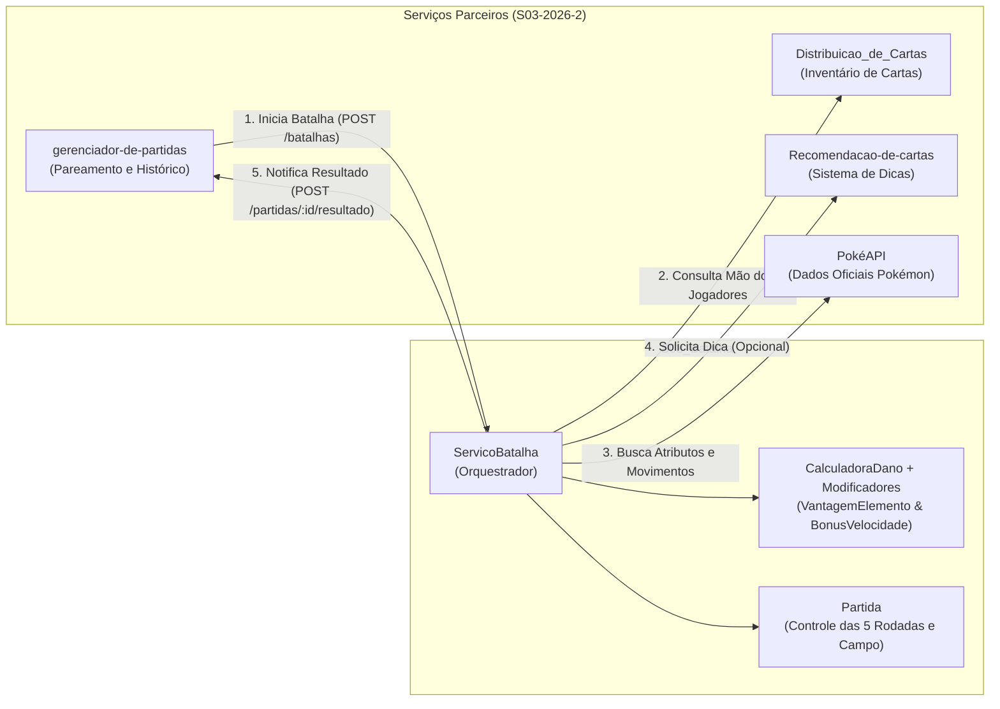

# ⚔️ S03_Batalha — Sistema de Batalhas Pokémon

Projeto da disciplina **S03 – Arquitetura e Desenho de Software** (Inatel) — Organização [`S03-2026-2`](https://github.com/S03-2026-2).

O módulo **`S03_Batalha`** é responsável por conduzir o combate entre os Pokémons de dois jogadores pareados pelo módulo de **Gestão de Partidas**. A batalha ocorre em **até 5 rodadas** (pode encerrar antes se o perdedor ficar sem cartas), utilizando **probabilidades ponderadas** calculadas a partir dos movimentos, da vantagem elemental entre tipos de Pokémon e do bônus de velocidade. Os jogadores revezam na ordem de escolha a cada rodada, o **Pokémon vencedor permanece em campo** para a rodada seguinte e vence a partida o jogador com o maior número de vitórias de rodada.

---

## 🧭 Visão Geral no Ecossistema `S03-2026-2`



---

## 📚 Documentação de Arquitetura e Projeto

A documentação completa do projeto está organizada nas pastas [`docs/`](docs/) (documentos em Markdown e diagramas renderizáveis no GitHub) e [`documentation/`](documentation/) (arquivos fontes editáveis `.drawio` e `.xlsx`):

| Documento | Conteúdo Principal |
| :--- | :--- |
| [**01 – Requisitos e Regras de Negócio**](docs/01-requisitos-e-regras.md) | Escopo, RF01–RF09, RNF01–RNF05, permanência em campo, fórmula ponderada e **RN05** (até 5 rodadas, com fim antecipado por falta de cartas). |
| [**02 – Casos de Uso**](docs/02-casos-de-uso.md) | Diagrama e especificação `UC01`–`UC08` alinhados às rotas e assinaturas reais. |
| [**03 – Arquitetura, Diagrama de Classes e SOLID**](docs/03-arquitetura-e-solid.md) | Evolução Entrega 1→2, diagrama de classes **atualizado ao código**, pastas reais e SOLID na prática. |
| [**04 – Contratos de Integração e Sequência**](docs/04-contratos-de-integracao.md) | Rotas REST, payloads (`callbackUrl`, pontuações, `/api/dica`) e sequências SQ01/SQ02 alinhadas à implementação. |
| [**05 – Catálogo de Padrões de Projeto**](docs/05-padroes-de-projeto.md) | Handbook Strategy / Facade / Adapter / Decorator / Repository / Composition Root / Fakes, mapa SOLID, trade-offs e roteiro de demo. |

Os documentos `03`–`05` foram **revisados após feedback** para refletir o código atual (método `jogar` unificado, `tipos: list[str]`, Composition Root, contratos reais). Em caso de divergência com o `.drawio` histórico, use o Markdown + o código como fonte da verdade na apresentação.

### Arquivos Fontes de Diagramas (`documentation/`)
- [`documentation/SOLID.drawio`](documentation/SOLID.drawio) — Diagrama de Classes UML com aplicação dos princípios SOLID (Entrega 2).
- [`documentation/Diagrama Casos de Uso.drawio`](documentation/Diagrama%20Casos%20de%20Uso.drawio) — Diagrama de Casos de Uso UML editável no Diagrams.net.
- [`documentation/Documentação Casos de Uso.xlsx`](documentation/Documenta%C3%A7%C3%A3o%20Casos%20de%20Uso.xlsx) — Planilha original de especificação de casos de uso.
- [`documentation/WhatsApp Image 2026-10-01 at 18.58.29.jpeg`](documentation/WhatsApp%20Image%202026-10-01%20at%2018.58.29.jpeg) — Registro histórico da primeira versão do Diagrama de Classes (Entrega 1).

---

## ⚖️ Síntese das Decisões Arquiteturais (SOLID)

Pastas: `models/` (domínio), `interfaces/` (portas), `services/` (aplicação), `controllers/` (**adapters** HTTP/memória/fake), `composicao.py` (Composition Root), `app.py` + `components/` (apresentação).

- **S — Single Responsibility Principle (SRP):**
  - `ServicoBatalha` orquestra os casos de uso (Facade);
  - `Partida` guarda estado (turno, placar, campo, término até 5 rodadas ou por falta de cartas);
  - `JuizRodada` + `CalculadoraDano` separam sorteio e força;
  - adapters em `controllers/` isolam cada serviço externo.
- **O — Open/Closed Principle (OCP):**
  - `VantagemElemento`, `BonusVelocidade` (e futuros clima/STAB) implementam `ModificadorDano` sem alterar a calculadora.
- **L — Liskov Substitution Principle (LSP):**
  - `PokeApiProvider` × `ProvedorFake` × `ProvedorPokemonComCache`; nos testes: `GestaoFake`, `MaosFixas`, `GeradorFixo`.
- **I — Interface Segregation Principle (ISP):**
  - Entrada: `IniciadorPartida` vs `AcoesJogador` (inclui `jogar` unificado).
  - Saída Gestão: `SolicitadorPareamento` vs `NotificadorPartidas`.
- **D — Dependency Inversion Principle (DIP):**
  - `ServicoBatalha` só recebe interfaces; `src/composicao.py` escolhe as concretas via env.

Catálogo completo para a banca: [`docs/05-padroes-de-projeto.md`](docs/05-padroes-de-projeto.md).

---

## ▶️ Como rodar

Requisitos: Python 3.11+.

**1. Batalha (backend, porta 3001)**

```bash
cd src
pip install -r requirements.txt
# opcional para testes: pip install -r requirements-dev.txt
python app.py
```

Há um [`.env.example`](.env.example) na raiz com as variáveis opcionais.

**2. Telas (porta 5371)**, em outro terminal:

```bash
cd src/components
python -m http.server 5371
```

Abra `http://localhost:5371`.

**3. Gestão de Partidas (porta 3000)**, para o fluxo completo com fila:

```bash
# no repositório gerenciador-de-partidas
docker-compose up -d                    # PostgreSQL
npm install
npx prisma migrate dev --name init
npm run dev
```

No `.env` do gerenciador, `USE_MOCK_BATALHA` precisa ser `false`. Com `true` (o padrão do `.env.example`) o gerenciador simula a batalha sozinho, nunca chama este serviço e a arena fica esperando. Os outros valores do `.env.example` já apontam para cá (`BATALHA_API_URL=http://localhost:3001` e `CALLBACK_RESULTADO_URL=http://localhost:3000/partidas/resultado`).

Com tudo rodando, cada jogador abre `http://localhost:5371` em uma aba, entra na fila e cai na arena. No fim da partida a batalha manda o resultado para o gerenciador.

**Sem o gerenciador:** na tela inicial, abra "Sem o gerenciador? Criar a partida direto na batalha", informe o adversário e abra o link dele em outra aba. Só os passos 1 e 2 são necessários. O resultado final não é registrado em lugar nenhum, porque não há gerenciador para recebê-lo.

Variáveis de ambiente (todas opcionais):

| Variável | Para que serve | Padrão |
| :--- | :--- | :--- |
| `PORT` | Porta da API | `3001` |
| `GESTAO_API_URL` | gerenciador-de-partidas | `http://localhost:3000` |
| `DISTRIBUICAO_API_URL` | Distribuicao_de_Cartas. Vazio = mão sorteada localmente | vazio |
| `RECOMENDACAO_API_URL` / `RECOMENDACAO_TOKEN` | Recomendacao-de-cartas. Sem token = dica calculada localmente | `http://localhost:5242` / vazio |
| `BATALHA_OFFLINE=1` | Não acessa a PokéAPI (usa um catálogo fixo de 12 Pokémon) | desligado |

Testes (rodam sem internet):

```bash
cd src
python -m pytest
```

### Endpoints

| Método | Rota | Uso |
| :--- | :--- | :--- |
| `POST` | `/batalhas` | Gestão de Partidas inicia a batalha (`idPartida`, `idJogador1`, `idJogador2`, `callbackUrl`) |
| `POST` | `/batalhas/solicitar` | Jogador pede para entrar na fila |
| `GET` | `/batalhas/{idPartida}?jogador={id}` | Estado da partida do ponto de vista do jogador |
| `GET` | `/batalhas/{idPartida}/cartas/{idCarta}` | Analisar carta |
| `POST` | `/batalhas/{idPartida}/jogadas` | Jogar (`idJogador`, `idCarta`, `nomeMovimento`) |
| `POST` | `/batalhas/{idPartida}/dica` | Pedir dica (`idJogador`) |

A documentação interativa fica em `http://localhost:3001/docs`.
