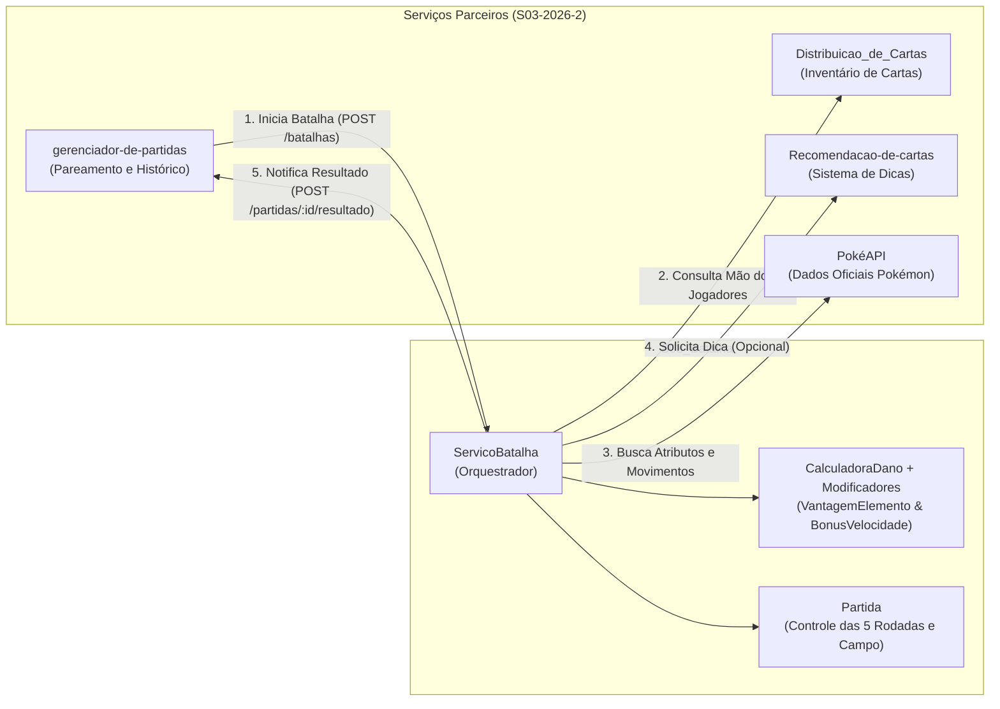

# ⚔️ S03_Batalha — Sistema de Batalhas Pokémon

Projeto da disciplina **S03 – Arquitetura e Desenho de Software** (Inatel) — Organização [`S03-2026-2`](https://github.com/S03-2026-2).

O módulo **`S03_Batalha`** é responsável por conduzir o combate entre os Pokémons de dois jogadores pareados pelo módulo de **Gestão de Partidas**. A batalha ocorre ao longo de **5 rodadas**, utilizando **probabilidades ponderadas** calculadas a partir dos movimentos, da vantagem elemental entre tipos de Pokémon e do bônus de velocidade. Os jogadores revezam na ordem de escolha a cada rodada, o **Pokémon vencedor permanece em campo** para a rodada seguinte e vence a partida o jogador que conquistar o maior número de vitórias nas 5 rodadas.

---

## 🧭 Visão Geral no Ecossistema `S03-2026-2`

---

## 📚 Documentação de Arquitetura e Projeto

A documentação completa do projeto está organizada nas pastas [`docs/`](docs/) (documentos em Markdown e diagramas renderizáveis no GitHub) e [`documentation/`](documentation/) (arquivos fontes editáveis `.drawio` e `.xlsx`):

| Documento | Conteúdo Principal |
| :--- | :--- |
| [**01 – Requisitos e Regras de Negócio**](docs/01-requisitos-e-regras.md) | Escopo do módulo, Requisitos Funcionais (RF01–RF09), Requisitos Não Funcionais (RNF01–RNF05), regra de permanência do Pokémon vencedor em campo e fórmula matemática da probabilidade ponderada por rodada. |
| [**02 – Casos de Uso**](docs/02-casos-de-uso.md) | Diagrama de Casos de Uso atualizado e especificação detalhada de fluxos principais, alternativos e de exceção (`UC01` a `UC08`). |
| [**03 – Arquitetura, Diagrama de Classes e SOLID**](docs/03-arquitetura-e-solid.md) | Evolução da Entrega 1 para a Entrega 2, Diagrama de Classes completo e justificativa prática de **SRP**, **OCP**, **LSP**, **ISP**, **DIP**, **Lei de Demeter** e **Ocultamento de Informação**. |
| [**04 – Contratos de Integração e Sequência**](docs/04-contratos-de-integracao.md) | Especificação das rotas REST, payloads JSON trocados com `gerenciador-de-partidas`, `Distribuicao_de_Cartas`, `Recomendacao-de-cartas` e `PokéAPI`, além dos Diagramas de Sequência. |
| [**Plano de Ação e Implementação**](PLANO_DE_ACAO.md) | Roteiro técnico para evolução do repositório e implementação em TypeScript / Node.js (Express). |

### Arquivos Fontes de Diagramas (`documentation/`)
- [`documentation/SOLID.drawio`](documentation/SOLID.drawio) — Diagrama de Classes UML com aplicação dos princípios SOLID (Entrega 2).
- [`documentation/Diagrama Casos de Uso.drawio`](documentation/Diagrama%20Casos%20de%20Uso.drawio) — Diagrama de Casos de Uso UML editável no Diagrams.net.
- [`documentation/Documentação Casos de Uso.xlsx`](documentation/Documenta%C3%A7%C3%A3o%20Casos%20de%20Uso.xlsx) — Planilha original de especificação de casos de uso.
- [`documentation/WhatsApp Image 2026-10-01 at 18.58.29.jpeg`](documentation/WhatsApp%20Image%202026-10-01%20at%2018.58.29.jpeg) — Registro histórico da primeira versão do Diagrama de Classes (Entrega 1).

---

## ⚖️ Síntese das Decisões Arquiteturais (SOLID)

- **S — Single Responsibility Principle (SRP):**
  - `ServicoBatalha` orquestra o fluxo de aplicação;
  - `Partida` gerencia exclusivamente o estado das 5 rodadas, o placar e qual Pokémon vencedor permanece ativo em campo;
  - `CalculadoraDano` calcula a força de combate a partir dos modificadores;
  - `PokeApiProvider`, `ClienteDistribuicao`, `ClienteGestao` e `ClienteDicas` isolam a comunicação externa.
- **O — Open/Closed Principle (OCP):**
  - Novas regras de combate (ex.: `VantagemElemento`, `BonusVelocidade`, ou futuros modificadores de clima/STAB) implementam a interface `ModificadorDano` e são injetadas em `CalculadoraDano` sem necessidade de alterar o código existente.
- **L — Liskov Substitution Principle (LSP):**
  - `PokeApiProvider` e `ProvedorFake` (assim como os demais clientes HTTP e seus respectivos Fakes) implementam exatamente o mesmo contrato (`ProvedorPokemon`), podendo substituir um ao outro em testes ou execução local sem quebrar o `ServicoBatalha`.
- **I — Interface Segregation Principle (ISP):**
  - As portas de entrada foram separadas em `IniciadorPartida` (usada pela Gestão de Partidas) e `AcoesJogador` (usada pelos jogadores).
  - A integração com Gestão de Partidas foi dividida em duas interfaces menores e focadas: `SolicitadorPareamento` e `NotificadorPartidas`.
- **D — Dependency Inversion Principle (DIP):**
  - `ServicoBatalha` depende apenas de interfaces abstratas (`ProvedorPokemon`, `FonteCartas`, `ProvedorDicas`, `SolicitadorPareamento`, `NotificadorPartidas`, `RepositorioPartidas`, `GeradorAleatorio`), recebendo as implementações concretas no construtor.
