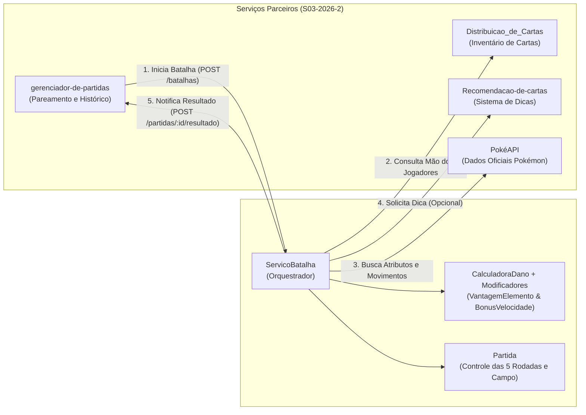

# ⚔️ S03_Batalha — Sistema de Batalhas Pokémon

Projeto da disciplina **S03 – Arquitetura e Desenho de Software** (Inatel) — Organização [`S03-2026-2`](https://github.com/S03-2026-2).

O módulo **`S03_Batalha`** é responsável por conduzir o combate entre os Pokémons de dois jogadores pareados pelo módulo de **Gestão de Partidas**. A batalha ocorre em **até 5 rodadas** (pode encerrar antes se o perdedor ficar sem cartas), utilizando **probabilidades ponderadas** calculadas a partir dos movimentos, da vantagem elemental entre tipos de Pokémon e do bônus de velocidade. Os jogadores revezam na ordem de escolha a cada rodada, o **Pokémon vencedor permanece em campo** para a rodada seguinte e vence a partida o jogador com o maior número de vitórias de rodada.

---

## 🧭 Visão Geral no Ecossistema `S03-2026-2`



---

## 📚 Documentação de Arquitetura e Projeto

A documentação completa do projeto está organizada nas pastas [`docs/`](docs/) (documentos em Markdown e diagramas renderizáveis no GitHub) e [`documentation/`](documentation/) (arquivos fontes editáveis `.drawio` e `.xlsx`):

| Documento | Conteúdo Principal |
| :--- | :--- |
| [**01 – Requisitos e Regras de Negócio**](docs/01-requisitos-e-regras.md) | Escopo, RF01–RF09, RNF01–RNF05, permanência em campo, fórmula ponderada e RN05 (até 5 rodadas, com fim antecipado por falta de cartas). |
| [**02 – Casos de Uso**](docs/02-casos-de-uso.md) | Diagrama e especificação dos casos de uso `UC01`–`UC08`. |
| [**03 – Arquitetura, Diagrama de Classes e SOLID**](docs/03-arquitetura-e-solid.md) | Evolução Entrega 1→2, diagrama de classes, organização de pastas e aplicação dos princípios SOLID. |
| [**04 – Contratos de Integração e Sequência**](docs/04-contratos-de-integracao.md) | Rotas REST, payloads JSON e diagramas de sequência com os serviços parceiros. |
| [**05 – Padrões de Projeto**](docs/05-padroes-de-projeto.md) | Strategy, Facade, Adapter, Decorator, Repository, Composition Root, fakes de teste e mapa SOLID no código. |

### Arquivos Fontes de Diagramas (`documentation/`)
- [`documentation/SOLID.drawio`](documentation/SOLID.drawio) — Diagrama de Classes UML com aplicação dos princípios SOLID (Entrega 2).
- [`documentation/Diagrama Casos de Uso.drawio`](documentation/Diagrama%20Casos%20de%20Uso.drawio) — Diagrama de Casos de Uso UML editável no Diagrams.net.
- [`documentation/Documentação Casos de Uso.xlsx`](documentation/Documenta%C3%A7%C3%A3o%20Casos%20de%20Uso.xlsx) — Planilha original de especificação de casos de uso.
- [`documentation/WhatsApp Image 2026-10-01 at 18.58.29.jpeg`](documentation/WhatsApp%20Image%202026-10-01%20at%2018.58.29.jpeg) — Registro histórico da primeira versão do Diagrama de Classes (Entrega 1).

---

## ⚖️ Síntese das Decisões Arquiteturais (SOLID)

Organização: `models/` (domínio), `interfaces/` (portas), `services/` (aplicação), `controllers/` (adapters HTTP/memória/fake), `composicao.py` (Composition Root), `app.py` + `components/` (API e telas).

- **S — Single Responsibility Principle (SRP):**
  - `ServicoBatalha` orquestra os casos de uso (Facade);
  - `Partida` guarda estado (turno, placar, campo, término até 5 rodadas ou por falta de cartas);
  - `JuizRodada` + `CalculadoraDano` separam sorteio e força;
  - adapters em `controllers/` isolam cada serviço externo.
- **O — Open/Closed Principle (OCP):**
  - `VantagemElemento`, `BonusVelocidade` (e futuros clima/STAB) implementam `ModificadorDano` sem alterar a calculadora.
- **L — Liskov Substitution Principle (LSP):**
  - `PokeApiProvider` × `ProvedorFake` × `ProvedorPokemonComCache`; nos testes: `GestaoFake`, `MaosFixas`, `GeradorFixo`.
- **I — Interface Segregation Principle (ISP):**
  - Entrada: `IniciadorPartida` vs `AcoesJogador` (método `jogar` unificado).
  - Saída Gestão: `SolicitadorPareamento` vs `NotificadorPartidas`.
- **D — Dependency Inversion Principle (DIP):**
  - `ServicoBatalha` só recebe interfaces; `src/composicao.py` escolhe as concretas via env.

Detalhamento dos padrões: [`docs/05-padroes-de-projeto.md`](docs/05-padroes-de-projeto.md).

---

## ✅ Pré-requisitos

- **Python 3.11+** e **pip** (em distribuições Linux/Ubuntu/Debian, também é recomendado ter o pacote `python3-venv` instalado para criar ambientes virtuais)
- **Para o fluxo completo integrado com fila e histórico (`gerenciador-de-partidas`):**
  - **Node.js v18+** e **npm**
  - **Docker** e **Docker Compose** (para o banco de dados PostgreSQL local)

---

## ▶️ Passo a Passo de Instalação e Execução

### 1. Criar e ativar o ambiente virtual (recomendado)

Na raiz do repositório `S03_Batalha`, crie e ative um ambiente virtual para isolar as dependências do projeto (e evitar o erro `externally-managed-environment` em sistemas Linux recentes):

**Linux / macOS:**
```bash
# Caso esteja no Ubuntu/Debian e o módulo venv ainda não esteja instalado:
# sudo apt install python3-venv

python3 -m venv .venv
source .venv/bin/activate
```

**Windows (PowerShell):**
```powershell
python -m venv .venv
.\.venv\Scripts\Activate.ps1
```

### 2. Instalar dependências

Com o ambiente virtual ativo, instale as dependências de execução:

```bash
pip install -r src/requirements.txt
```

Opcionalmente, instale também as dependências de desenvolvimento para rodar os testes automatizados:

```bash
pip install -r src/requirements-dev.txt
```

### 3. Configurar variáveis de ambiente (opcional)

Nenhuma variável é obrigatória para rodar a demonstração local (com mão sorteada localmente e dica local). Caso deseje customizar URLs ou rodar em modo offline, copie o arquivo [`.env.example`](.env.example) para `.env`:

```bash
cp .env.example .env
```

Conteúdo padrão do `.env.example`:

```env
PORT=3001
GESTAO_API_URL=http://localhost:3000

# Vazio = FonteCartasLocal (sorteia a mão neste serviço)
DISTRIBUICAO_API_URL=

# Serviço de dicas (.NET). Sem token = DicaLocal
RECOMENDACAO_API_URL=http://localhost:5242
RECOMENDACAO_TOKEN=

# 1 = não acessa a PokéAPI (catálogo fixo ProvedorFake)
BATALHA_OFFLINE=
```

| Variável | Para que serve | Padrão |
| :--- | :--- | :--- |
| `PORT` | Porta da API de Batalha | `3001` |
| `GESTAO_API_URL` | URL do `gerenciador-de-partidas` | `http://localhost:3000` |
| `DISTRIBUICAO_API_URL` | URL do `Distribuicao_de_Cartas` (vazio = mão sorteada localmente) | vazio |
| `RECOMENDACAO_API_URL` / `RECOMENDACAO_TOKEN` | URL e token Bearer do `Recomendacao-de-cartas` (sem token = dica calculada localmente) | `http://localhost:5242` / vazio |
| `BATALHA_OFFLINE` | Se `1`, não acessa a PokéAPI e usa um catálogo fixo de 12 Pokémon | desligado |

> **Nota:** o `S03_Batalha` lê as variáveis diretamente do ambiente do sistema (`os.getenv`). Se você criou um arquivo `.env`, carregue-o no terminal antes de subir a API:
> ```bash
> # Linux / macOS
> set -a && source .env && set +a
> ```
> Ou informe a variável diretamente ao iniciar o servidor (ex.: `BATALHA_OFFLINE=1 python app.py`).

#### Alternando entre Modo Independente/Offline e Integração Real

- **Modo Independente (sem serviços parceiros):**
  Deixe `DISTRIBUICAO_API_URL` e `RECOMENDACAO_TOKEN` vazios. O serviço sorteia as cartas localmente, calcula dicas localmente e permite criar partidas diretamente pela interface web sem precisar do `gerenciador-de-partidas`. Se também estiver sem internet, defina `BATALHA_OFFLINE=1` para usar o catálogo fixo (`ProvedorFake`) no lugar da PokéAPI.
- **Modo Integração Real (com `gerenciador-de-partidas`):**
  Suba o `gerenciador-de-partidas` na porta `3000` com `USE_MOCK_BATALHA=false` (veja o passo 6). Ao formar um par na fila, o gerenciador envia `POST /batalhas` para este serviço e recebe automaticamente o resultado final ao término da partida.

### 4. Iniciar o backend da Batalha (porta `3001`)

Com o ambiente virtual ativo:

```bash
cd src
python app.py
```

O servidor estará disponível em `http://localhost:3001`.

#### Documentação Interativa (Swagger UI)

Com o backend rodando, acesse no navegador:

- **Swagger UI:** `http://localhost:3001/docs`
- **ReDoc:** `http://localhost:3001/redoc`

### 5. Iniciar as telas / frontend (porta `5371`)

Em **outro terminal**, sirva os arquivos estáticos da interface:

```bash
cd src/components
python3 -m http.server 5371
```

Abra `http://localhost:5371` no navegador.

### 6. Executar o fluxo completo com o Gestão de Partidas (porta `3000`)

Para jogar usando a fila de matchmaking e registrar histórico/pontuação no banco de dados, execute também o repositório parceiro **`gerenciador-de-partidas`** em um terceiro terminal:

1. Clone ou acesse o repositório `gerenciador-de-partidas`:
   ```bash
   git clone https://github.com/S03-2026-2/gerenciador-de-partidas.git
   cd gerenciador-de-partidas
   ```
2. Copie o `.env.example` para `.env`:
   ```bash
   cp .env.example .env
   ```
3. **Ajuste obrigatório no `.env` do `gerenciador-de-partidas`:**
   ```env
   USE_MOCK_BATALHA=false
   ```
   > **Atenção:** no `.env.example` do gerenciador, o valor padrão é `USE_MOCK_BATALHA=true`. Com `true`, o gerenciador simula a batalha sozinho, nunca chama o `S03_Batalha` e a tela da arena ficará parada em *"Aguardando o gerenciador enviar a partida para a batalha…"*. Sempre reinicie o `npm run dev` após editar o `.env`. Os demais valores padrão já apontam corretamente para este serviço (`BATALHA_API_URL="http://localhost:3001"` e `CALLBACK_RESULTADO_URL="http://localhost:3000/partidas/resultado"`).
4. Suba o PostgreSQL, instale dependências, rode as migrations e inicie o servidor:
   ```bash
   docker compose up -d                    # ou: docker-compose up -d
   npm install
   npx prisma migrate dev --name init
   npx prisma generate
   npm run dev
   ```

Com os **3 terminais rodando** (Gestão na `3000`, Batalha na `3001` e Telas na `5371`), abra `http://localhost:5371` em **duas abas diferentes** (um jogador em cada aba), informe IDs diferentes, clique em **Buscar adversário** e ambos serão direcionados para a arena. Ao fim da partida, o `S03_Batalha` envia o resultado automaticamente para o gerenciador.

#### Executando sem o Gestão de Partidas

Se quiser testar apenas a batalha sem subir o `gerenciador-de-partidas` (apenas passos 4 e 5 rodando):

1. Acesse `http://localhost:5371`.
2. Informe seu ID de jogador no campo superior.
3. Expanda a opção **"Sem o gerenciador? Criar a partida direto na batalha"**.
4. Informe o ID do adversário e clique em **Criar partida local**.
5. Abra o link gerado para o adversário em outra aba e jogue normalmente. *(Nesse modo, o resultado final não é persistido em banco, pois não há gerenciador para recebê-lo.)*

### 7. Executar os testes automatizados

Os testes rodam totalmente offline (sem acesso à internet ou serviços externos):

```bash
cd src
python -m pytest
```

---

## 🔌 Endpoints

| Método | Rota | Uso |
| :--- | :--- | :--- |
| `POST` | `/batalhas` | Gestão de Partidas inicia a batalha (`idPartida`, `idJogador1`, `idJogador2`, `callbackUrl`) |
| `POST` | `/batalhas/solicitar` | Jogador pede para entrar na fila via fachada da Batalha |
| `GET` | `/batalhas/{idPartida}?jogador={id}` | Consulta o estado da partida do ponto de vista de um jogador |
| `GET` | `/batalhas/{idPartida}/cartas/{idCarta}` | Analisa os atributos e movimentos de uma carta |
| `POST` | `/batalhas/{idPartida}/jogadas` | Registra a jogada da rodada (`idJogador`, `idCarta`, `nomeMovimento`) |
| `POST` | `/batalhas/{idPartida}/dica` | Solicita uma dica de jogada (`idJogador`) |

Para payloads completos, contratos de saída e diagramas de sequência, consulte [`docs/04-contratos-de-integracao.md`](docs/04-contratos-de-integracao.md). Com o servidor rodando, a documentação interativa (Swagger UI) fica disponível em `http://localhost:3001/docs`.
