# 01 – Requisitos e Regras de Negócio (`S03_Batalha`)

Este documento descreve o escopo, os requisitos funcionais e não funcionais e as regras de negócio detalhadas do módulo **Sistema de Batalha (`S03_Batalha`)** dentro do projeto da disciplina **S03 – Arquitetura e Desenho de Software**.

---

## 1. Enunciado e Escopo do Módulo

> *"Responsável por realizar um combate entre os Pokémons dos jogadores. Recebe a requisição da aplicação de gestão de partidas. A batalha deve usar probabilidades considerando os tipos de cada Pokémon. Os jogadores revezam na escolha de qual será o Pokémon utilizado. O Pokémon vencedor permanece no campo para uma nova rodada. Vence a batalha o jogador que vencer o maior número de rodadas entre as 5 rodadas."*

### O que pertence ao escopo de `S03_Batalha`:
- Receber a requisição de abertura de partida vinda do módulo **Gestão de Partidas (`gerenciador-de-partidas`)** contendo o identificador da partida e os dois jogadores pareados.
- Solicitar o pareamento de um jogador junto à **Gestão de Partidas** quando acionado diretamente pelo jogador.
- Consultar a mão de cartas de cada jogador no serviço **Distribuição de Cartas (`Distribuicao_de_Cartas`)**.
- Enriquecer e consultar os atributos oficiais de cada Pokémon (tipo, velocidade e movimentos) na **PokéAPI (`pokeapi.co`)**.
- Permitir que o jogador solicite uma recomendação estratégica de jogada ao serviço **Recomendação de Cartas (`Recomendacao-de-cartas`)**.
- Conduzir o ciclo de até **5 rodadas** controlando o revezamento de turno, a manutenção do Pokémon vencedor em campo, o descarte da carta derrotada e o sorteio probabilístico ponderado pelos modificadores de dano.
- Notificar o resultado consolidado (vencedor, perdedor e resumo das rodadas) de volta ao serviço **Gestão de Partidas**.

### O que NÃO pertence ao escopo de `S03_Batalha`:
- Cadastro ou autenticação de credenciais de usuários (responsabilidade do grupo `Jogadores`).
- Fila de matchmaking ou ranking histórico de pontuação (responsabilidade do grupo `gerenciador-de-partidas`).
- Sorteio inicial de pacotes/inventário permanente de cartas (responsabilidade do grupo `Distribuicao_de_Cartas`).
- Motor de regras de IA/vetores para cálculo de dicas (responsabilidade do grupo `Recomendacao-de-cartas`).

---

## 2. Requisitos Funcionais (RF)

| Código | Requisito | Descrição |
| :--- | :--- | :--- |
| **RF01** | Solicitar Batalha | O sistema deve permitir que um jogador solicite entrar na fila de pareamento enviando seu identificador ao módulo de Gestão de Partidas. |
| **RF02** | Iniciar Partida | O sistema deve iniciar uma nova batalha ao receber `idPartida`, `idJogador1` e `idJogador2` da Gestão de Partidas, buscando as cartas iniciais dos dois jogadores na Distribuição de Cartas. |
| **RF03** | Analisar Carta | O sistema deve permitir consultar os atributos detalhados do Pokémon de uma carta (tipos, velocidade e lista de movimentos com dano base) através da PokéAPI. |
| **RF04** | Solicitar Dica | Durante seu turno de escolha, o jogador pode solicitar uma dica de qual carta/movimento utilizar, consultando o serviço de Recomendação de Cartas. |
| **RF05** | Escolher Carta e Movimento | O sistema deve registrar a jogada de cada jogador na rodada atual, respeitando o revezamento de quem escolhe primeiro e a regra de permanência do Pokémon vencedor da rodada anterior. |
| **RF06** | Calcular Força com Modificadores | O sistema deve calcular a pontuação de combate de cada jogada a partir do `danoBase` do movimento escolhido, aplicando modificadores extensíveis como **Vantagem de Elemento (Tipo)** e **Bônus de Velocidade**. |
| **RF07** | Resolver Rodada por Probabilidade | O sistema deve determinar o vencedor de cada rodada por sorteio probabilístico ponderado pelas forças calculadas dos dois Pokémons em combate. |
| **RF08** | Manter Pokémon Vencedor em Campo | Ao término de uma rodada, o Pokémon vencedor deve permanecer ativo em campo para a rodada seguinte, enquanto a carta do Pokémon perdedor deve ser removida da mão/campo do jogador derrotado. |
| **RF09** | Verificar Vencedor e Notificar Resultado | Ao concluir as 5 rodadas, o sistema deve apurar o jogador com maior número de vitórias nas rodadas e enviar o resultado (`idVencedor`, `idPerdedor`, `detalhes`) para a Gestão de Partidas. |

---

## 3. Requisitos Não Funcionais (RNF)

| Código | Categoria | Descrição |
| :--- | :--- | :--- |
| **RNF01** | Desacoplamento (DIP/ISP) | O núcleo de domínio (`ServicoBatalha`, `Partida`, `CalculadoraDano`) não deve depender de bibliotecas HTTP, banco de dados ou implementações concretas dos outros grupos; toda comunicação externa deve ocorrer via interfaces segregadas. |
| **RNF02** | Extensibilidade (OCP) | Novas regras de cálculo de vantagem/bônus na batalha devem poder ser adicionadas através de novas classes que implementem `ModificadorDano`, sem modificar `CalculadoraDano` ou `ServicoBatalha`. |
| **RNF03** | Testabilidade e Substituibilidade (LSP) | Todo provedor externo (`PokeApiProvider`, `ClienteDistribuicao`, `ClienteGestao`, `ClienteDicas`) deve possuir uma implementação `Fake` equivalente que cumpra o mesmo contrato para execução de testes automatizados e simulações offline. |
| **RNF04** | Determinismo em Testes | O gerador de números aleatórios usado na resolução probabilística da rodada deve ser abstraído por interface (`GeradorAleatorio`), permitindo injetar valores fixos durante testes unitários. |
| **RNF05** | Interoperabilidade HTTP/JSON | A API REST deve expor contratos JSON compatíveis com o cliente HTTP já implementado pelo grupo `gerenciador-de-partidas` (`POST /batalhas` e callback em `POST /partidas/:id/resultado`). |

---

## 4. Regras de Negócio Detalhadas (RN)

### RN01 – Estrutura da Partida e Revezamento de Turnos
1. Cada partida é disputada por exatamente **2 jogadores** (`jogador1` e `jogador2`) ao longo de **5 rodadas**.
2. Na **Rodada 1**, o `jogador1` tem a prioridade de escolha, seguido pelo `jogador2`.
3. A cada nova rodada, a ordem de quem realiza a escolha primeiro se alterna (revezamento):
   - Rodadas ímpares (1, 3, 5): `jogador1` inicia a escolha.
   - Rodadas pares (2, 4): `jogador2` inicia a escolha.

### RN02 – Permanência do Pokémon Vencedor em Campo
1. Na **Rodada 1**, ambos os jogadores selecionam uma `Carta` da sua mão e um `Movimento` daquele Pokémon.
2. Ao final de cada rodada $t \in \{1, 2, 3, 4\}$:
   - **Vencedor da rodada:** seu Pokémon **permanece em campo** (`cartaEmCampo`). Na rodada $t+1$, ele **não troca de carta** — permanece com o mesmo Pokémon ativo e escolhe qual `Movimento` desse Pokémon utilizará na nova rodada.
   - **Perdedor da rodada:** sua carta derrotada é **eliminada** da mão e removida do campo. Na rodada $t+1$, o jogador derrotado deve escolher uma **nova carta** disponível em sua mão e o respectivo `Movimento`.

```mermaid
stateDiagram-v2
    [*] --> Rodada1: Recebe 5+ cartas por jogador
    Rodada1 --> ProcessandoRodada: J1 e J2 escolhem Carta + Movimento
    ProcessandoRodada --> AtualizandoCampo: Calcula forças S1 e S2 e sorteia vencedor
    AtualizandoCampo --> ProximaRodada: Turno < 5 (Vencedor mantém Pokémon em campo; Perdedor descarta carta)
    ProximaRodada --> ProcessandoRodada: Perdedor escolhe nova Carta + Movimento; Vencedor escolhe Movimento
    AtualizandoCampo --> PartidaFinalizada: Turno == 5 (5 rodadas concluídas)
    PartidaFinalizada --> [*]: Notifica Gestão de Partidas (Maior nº de vitórias em 5 rodadas)
```

### RN03 – Cálculo de Força (`CalculadoraDano` + `ModificadorDano`)
Para cada jogada na rodada, a força efetiva $S$ do Pokémon atacante contra o Pokémon defensor é calculada sequencialmente:

1. **Valor Inicial:** $d_0 = \text{movimento.danoBase}$ (caso o movimento não possua poder base na PokéAPI, utiliza-se um valor base padrão, ex.: `50`).
2. **Modificador 1 – `VantagemElemento`:**
   Verifica a relação entre o `tipo` do movimento/atacante e o `tipo` do Pokémon defensor:
   - **Super Efetivo (`2.0x`):** ex.: Água $\to$ Fogo, Fogo $\to$ Planta, Planta $\to$ Água, Elétrico $\to$ Água, Psíquico $\to$ Lutador, etc.
   - **Pouco Efetivo (`0.5x`):** relação inversa (ex.: Fogo $\to$ Água, Água $\to$ Planta, etc.).
   - **Neutro (`1.0x`):** demais combinações de tipos.
3. **Modificador 2 – `BonusVelocidade`:**
   Compara o atributo `velocidade` (`speed`) dos dois Pokémons:
   - Se $\text{atacante.velocidade} > \text{defensor.velocidade}$, aplica bônus de **+15% (`1.15x`)**.
   - Caso contrário, mantém **`1.0x`**.

### RN04 – Sorteio Probabilístico da Rodada
Obtidas as forças finais $S_1 > 0$ (Jogador 1) e $S_2 > 0$ (Jogador 2) pela `CalculadoraDano`:

$$P(\text{Vitória } J_1) = \frac{S_1}{S_1 + S_2}, \qquad P(\text{Vitória } J_2) = \frac{S_2}{S_1 + S_2} = 1 - P(\text{Vitória } J_1)$$

- Exemplo prático:
  - `Jogador 1` joga **Squirtle** (`Água`, velocidade `43`, movimento *Water Gun* `danoBase = 40`) contra **Charmander** (`Fogo`, velocidade `65`, movimento *Ember* `danoBase = 40`).
  - Força de Squirtle ($S_1$): $40 \times 2.0\text{ (vantagem Água vs Fogo)} \times 1.0\text{ (menor velocidade)} = 80$.
  - Força de Charmander ($S_2$): $40 \times 0.5\text{ (desvantagem Fogo vs Água)} \times 1.15\text{ (maior velocidade)} = 23$.
  - Probabilidades na rodada:
    $$P(J_1) = \frac{80}{80 + 23} \approx 77.67\%, \qquad P(J_2) = \frac{23}{103} \approx 22.33\%$$
- Um valor $r \in [0, 1)$ é obtido via `GeradorAleatorio.proximo()`:
  - Se $r < P(J_1)$, o **Jogador 1** vence a rodada;
  - Se $r \ge P(J_1)$, o **Jogador 2** vence a rodada.

### RN05 – Apuração do Vencedor da Partida
- Como são disputadas **5 rodadas** (número ímpar) e toda rodada possui exatamente 1 vencedor, ao final das 5 rodadas não há empate (placar possível: `5x0`, `4x1` ou `3x2`).
- Vence a batalha o jogador que acumular o maior número de rodadas vencidas entre as 5 rodadas.
