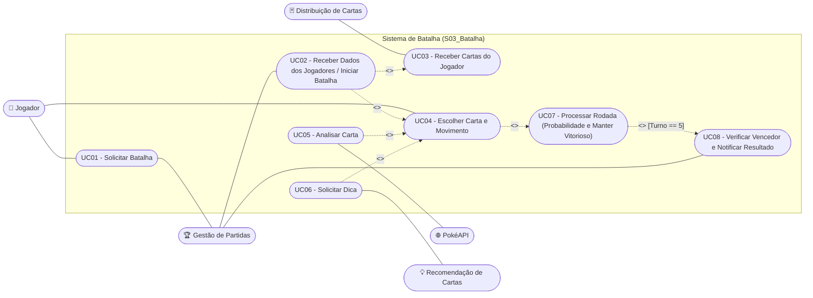

# 02 – Casos de Uso (`S03_Batalha`)

Este documento consolida o **Diagrama de Casos de Uso** e a **Especificação Detalhada dos Fluxos de Eventos** do módulo de Batalha, evoluindo a versão inicial ([`documentation/Diagrama Casos de Uso.drawio`](../documentation/Diagrama%20Casos%20de%20Uso.drawio) e [`documentation/Documentação Casos de Uso.xlsx`](../documentation/Documenta%C3%A7%C3%A3o%20Casos%20de%20Uso.xlsx)) para contemplar todas as interações presentes na arquitetura SOLID ([`documentation/SOLID.drawio`](../documentation/SOLID.drawio)).

---

## 1. Visão Geral e Atores do Sistema

| Ator | Tipo | Papel na Interação com `S03_Batalha` |
| :--- | :--- | :--- |
| **Jogador** | Principal (Humano) | Solicita batalha, analisa suas cartas, pede dicas e escolhe cartas/movimentos a cada rodada. |
| **Gestão de Partidas** (`gerenciador-de-partidas`) | Principal / Secundário (Sistema Externo) | Envia os jogadores pareados para iniciar a partida (`POST /batalhas`), recebe solicitações de fila e recebe a notificação do resultado final (`POST /partidas/:id/resultado`). |
| **Distribuição de Cartas** (`Distribuicao_de_Cartas`) | Secundário (Sistema Externo) | Fornece a lista de cartas disponíveis para cada jogador no início da batalha. |
| **PokéAPI** (`pokeapi.co`) | Secundário (API Externa) | Fornece os atributos oficiais do Pokémon (tipos, velocidade e movimentos). |
| **Recomendação de Cartas** (`Recomendacao-de-cartas`) | Secundário (Sistema Externo) | Gera dicas estratégicas para auxiliar o jogador na escolha da melhor carta/movimento na rodada. |

---

## 2. Diagrama de Casos de Uso

> O arquivo editável original está disponível em [`documentation/Diagrama Casos de Uso.drawio`](../documentation/Diagrama%20Casos%20de%20Uso.drawio). Abaixo está a representação integrada dos casos de uso e seus relacionamentos `<<include>>` e `<<extend>>`:

---

## 3. Especificação Detalhada dos Casos de Uso

### UC01 – Solicitar Batalha
| Campo | Descrição |
| :--- | :--- |
| **Caso de Uso Geral** | Batalha |
| **Ator Principal** | Jogador |
| **Atores Secundários** | Gestão de Partidas (`SolicitadorPareamento`) |
| **Resumo** | O jogador solicita entrar na fila de pareamento para enfrentar um adversário. |
| **Pré-Condições** | O jogador deve possuir um identificador válido no sistema. |
| **Pós-Condições** | O jogador é incluído na fila de matchmaking ou uma partida é imediatamente iniciada caso já haja oponente aguardando. |

**Fluxo Principal:**
1. O Jogador solicita uma nova batalha informando seu `idJogador`.
2. O Sistema aciona a interface `SolicitadorPareamento.solicitarPareamento(idJogador)`.
3. O módulo Gestão de Partidas registra o jogador na fila ou forma o par de competidores.
4. O Sistema confirma ao Jogador que a solicitação foi registrada.

**Fluxo de Exceção (1a – Serviço de Gestão Indisponível ou Jogador já em Partida):**
- O Sistema captura o erro retornado pelo cliente de Gestão e informa ao Jogador o motivo da recusa.

---

### UC02 – Iniciar Partida (Receber Dados dos Jogadores)
| Campo | Descrição |
| :--- | :--- |
| **Caso de Uso Geral** | Batalha |
| **Ator Principal** | Gestão de Partidas |
| **Atores Secundários** | Distribuição de Cartas (`FonteCartas`), PokéAPI (`ProvedorPokemon`) |
| **Resumo** | O sistema Gestão de Partidas envia o identificador da partida e dos dois jogadores pareados, e o sistema de Batalha configura o estado inicial das 5 rodadas. |
| **Pré-Condições** | Dois jogadores distintos foram pareados pelo serviço de Gestão de Partidas. |
| **Pós-Condições** | A instância de `Partida` é criada no turno 1 com as mãos dos dois jogadores carregadas e pronta para receber jogadas. |

**Fluxo Principal:**
1. O sistema Gestão de Partidas envia `idPartida`, `idJogador1` e `idJogador2` (`IniciadorPartida.iniciarPartida`).
2. O Sistema valida que `idJogador1` e `idJogador2` são distintos e que a partida ainda não foi iniciada.
3. O Sistema inclui o caso de uso **UC03 – Receber Cartas do Jogador** para ambos os jogadores.
4. O Sistema inicializa a entidade `Partida` com `turno = 1`, placar zerado (`0 x 0`) e nenhum Pokémon ainda ativo em campo.
5. O Sistema retorna a confirmação de criação da partida (`201 Created`).

---

### UC03 – Receber Cartas do Jogador (Consultar Cartas)
| Campo | Descrição |
| :--- | :--- |
| **Caso de Uso Geral** | Batalha |
| **Ator Principal** | Nenhum (incluído por UC02) |
| **Atores Secundários** | Distribuição de Cartas (`FonteCartas`), PokéAPI (`ProvedorPokemon`) |
| **Resumo** | O sistema consulta as cartas pertencentes a cada jogador e enriquece seus dados de combate na PokéAPI. |
| **Pré-Condições** | Os identificadores dos jogadores foram recebidos no início da partida. |
| **Pós-Condições** | Cada `Jogador` na `Partida` possui sua mão (`Carta[]`) associada aos respectivos objetos `Pokemon` e `Movimento[]`. |

**Fluxo Principal:**
1. O Sistema consulta `FonteCartas.cartasDoJogador(idJogador)` para cada competidor.
2. Para cada carta retornada, caso os atributos de combate do Pokémon (`tipo`, `velocidade`, `movimentos`) ainda não estejam preenchidos, o Sistema consulta `ProvedorPokemon.buscar(nomePokemon)`.
3. O Sistema associa as cartas enriquecidas à mão de cada `Jogador`.

---

### UC04 – Escolher Carta e Movimento (Jogar Carta)
| Campo | Descrição |
| :--- | :--- |
| **Caso de Uso Geral** | Batalha |
| **Ator Principal** | Jogador |
| **Atores Secundários** | PokéAPI (via UC05), Recomendação de Cartas (via UC06) |
| **Resumo** | O jogador seleciona a carta da sua mão (ou mantém o Pokémon vencedor da rodada anterior) e escolhe o movimento que usará na rodada atual. |
| **Pré-Condições** | 1. A partida deve estar em andamento (`turno` entre 1 e 5). 2. O jogador deve pertencer à partida e ainda não ter registrado jogada na rodada atual. |
| **Pós-Condições** | A `Jogada` do jogador é registrada na rodada; se ambos os jogadores já tiverem jogado, o sistema executa automaticamente **UC07 – Processar Rodada**. |

**Fluxo Principal:**
1. O Sistema apresenta ao Jogador as cartas disponíveis em sua mão e indica se ele já possui um Pokémon vitorioso ativo em campo (`cartaEmCampo`).
2. *(Pontos de Extensão: o Jogador pode executar **UC05 – Analisar Carta** ou **UC06 – Solicitar Dica** antes de confirmar sua jogada).*
3. Se o Jogador possui um Pokémon ativo em campo (vencedor da rodada anterior), o Sistema mantém automaticamente essa `Carta` e o Jogador seleciona apenas o `Movimento`.
4. Se o Jogador não possui Pokémon ativo em campo (Rodada 1 ou perdeu a rodada anterior), o Jogador seleciona uma `Carta` disponível em sua mão e um `Movimento` daquela carta.
5. O Sistema valida a carta e o movimento e cria o objeto `Jogada(jogador, carta, movimento)`.
6. Quando ambos os jogadores tiverem registrado suas jogadas na rodada, o Sistema inclui **UC07 – Processar Rodada**.

**Fluxos Alternativos / Exceção:**
- **3a. Jogador vencedor da rodada anterior tenta trocar de carta:** O Sistema ignora ou rejeita a troca de carta, garantindo a regra de negócio de que o Pokémon vencedor permanece em campo para a nova rodada.
- **4a. Carta escolhida não pertence à mão do jogador ou já foi eliminada:** O Sistema rejeita a jogada informando que a carta é inválida.

---

### UC05 – Analisar Carta (`<<extend>>` de UC04)
| Campo | Descrição |
| :--- | :--- |
| **Caso de Uso Geral** | Batalha |
| **Ator Principal** | Jogador |
| **Atores Secundários** | PokéAPI (`ProvedorPokemon`) |
| **Resumo** | O jogador consulta os detalhes técnicos de uma carta (tipos, velocidade e movimentos disponíveis) antes de decidir sua jogada. |
| **Pré-Condições** | A partida está ativa e a carta consultada existe na mão do jogador ou em campo. |
| **Pós-Condições** | Os detalhes do `Pokemon` são exibidos ao jogador sem avançar o turno. |

**Fluxo Principal:**
1. Durante a escolha de carta (UC04), o Jogador solicita analisar uma carta específica.
2. O Sistema aciona `ProvedorPokemon.buscar(nomePokemon)` para obter/confirmar os dados da PokéAPI.
3. O Sistema retorna o nome, tipo elemental, velocidade e lista de movimentos com seus respectivos tipos e danos base.

---

### UC06 – Solicitar Dica (`<<extend>>` de UC04)
| Campo | Descrição |
| :--- | :--- |
| **Caso de Uso Geral** | Batalha |
| **Ator Principal** | Jogador |
| **Atores Secundários** | Recomendação de Cartas (`ProvedorDicas`) |
| **Resumo** | O jogador solicita uma sugestão estratégica de qual carta/movimento jogar considerando sua mão atual e o Pokémon adversário em campo (se houver). |
| **Pré-Condições** | A partida está em andamento. |
| **Pós-Condições** | O jogador recebe uma recomendação textual/estruturada para auxiliar sua decisão. |

**Fluxo Principal:**
1. Durante a escolha de jogada (UC04), o Jogador aciona a opção de solicitar dica.
2. O Sistema reúne as cartas atuais da mão do Jogador e o Pokémon em campo do adversário (caso visível após ter permanecido da rodada anterior).
3. O Sistema chama `ProvedorDicas.gerarDica(maoJogador, cartaOponenteEmCampo)`.
4. O Sistema exibe a recomendação retornada pelo serviço `Recomendacao-de-cartas`.

---

### UC07 – Processar Rodada (Probabilidade e Manter Vitorioso)
| Campo | Descrição |
| :--- | :--- |
| **Caso de Uso Geral** | Batalha |
| **Ator Principal** | Nenhum (incluído por UC04) |
| **Atores Secundários** | Nenhum |
| **Resumo** | Calcula a força das duas jogadas aplicando os modificadores de dano, realiza o sorteio probabilístico ponderado, mantém o Pokémon vencedor em campo, elimina a carta perdedora e avança o turno. |
| **Pré-Condições** | Ambos os jogadores registraram suas jogadas na rodada atual. |
| **Pós-Condições** | 1. O placar da rodada é contabilizado. 2. A carta vencedora é mantida em `cartaEmCampo`. 3. A carta perdedora é removida da mão do jogador derrotado. 4. Se a 5ª rodada foi concluída, estende para **UC08 – Verificar Vencedor e Notificar Resultado**. |

**Fluxo Principal:**
1. O Sistema aciona `CalculadoraDano.calcular(movimentoJ1, pokemonJ1, pokemonJ2)` para obter a força $S_1$, aplicando `VantagemElemento` e `BonusVelocidade`.
2. O Sistema aciona `CalculadoraDano.calcular(movimentoJ2, pokemonJ2, pokemonJ1)` para obter a força $S_2$, aplicando `VantagemElemento` e `BonusVelocidade`.
3. O Sistema calcula a probabilidade de vitória do Jogador 1: $P(J_1) = S_1 / (S_1 + S_2)$.
4. O Sistema obtém um número aleatório $r \in [0, 1)$ através de `GeradorAleatorio.proximo()` e define o vencedor e o perdedor da rodada.
5. O Sistema registra a vitória da rodada em `Partida`, mantém a carta do vencedor em `cartaEmCampo` e remove a carta derrotada da mão do perdedor.
6. O Sistema incrementa o contador de rodadas (`turno`).
7. Se as 5 rodadas foram concluídas (`Partida.terminou() == true`), o Sistema executa **UC08 – Verificar Vencedor e Notificar Resultado**.

---

### UC08 – Verificar Vencedor e Notificar Resultado
| Campo | Descrição |
| :--- | :--- |
| **Caso de Uso Geral** | Batalha |
| **Ator Principal** | Nenhum (estendido por UC07 ao final da 5ª rodada) |
| **Atores Secundários** | Gestão de Partidas (`NotificadorPartidas`) |
| **Resumo** | Apura o vencedor geral das 5 rodadas e envia o resultado final para o módulo de Gestão de Partidas. |
| **Pré-Condições** | As 5 rodadas da batalha foram processadas (`Partida.terminou() == true`). |
| **Pós-Condições** | O resultado final é enviado ao serviço Gestão de Partidas (`POST /partidas/:id/resultado`). |

**Fluxo Principal:**
1. O Sistema consulta `Partida.vencedor()` e `Partida.perdedor()`, comparando o número de vitórias acumuladas nas 5 rodadas.
2. O Sistema monta o resumo detalhado do placar (ex.: `"Placar 3x2 em 5 rodadas"`).
3. O Sistema invoca `NotificadorPartidas.notificarResultado(idPartida, idVencedor, idPerdedor, detalhes)`.
4. O módulo Gestão de Partidas recebe a notificação, persiste o histórico da partida e atualiza a pontuação do vencedor.
