# 03 – Arquitetura, Diagrama de Classes e Princípios SOLID (`S03_Batalha`)

Este documento apresenta a evolução do desenho arquitetural do módulo **Sistema de Batalha (`S03_Batalha`)** e detalha como as propriedades e os princípios de projeto da disciplina **S03 – Arquitetura e Desenho de Software** foram aplicados.

O diagrama e as assinaturas neste documento acompanham a implementação atual (`jogar` unificado, `tipos: list[str]`, Composition Root em `composicao.py`). O arquivo editável [`documentation/SOLID.drawio`](../documentation/SOLID.drawio) registra a visão UML da Entrega 2.

---

## 1. Evolução Arquitetural: Da Entrega 1 para a Arquitetura SOLID

### 1.1. Modelo Inicial (Entrega 1)
Na primeira concepção ([`documentation/WhatsApp Image 2026-10-01 at 18.58.29.jpeg`](../documentation/WhatsApp%20Image%202026-10-01%20at%2018.58.29.jpeg)), o sistema possuía apenas 5 classes concretas acopladas diretamente:
- `Batalha` acumulava o estado da partida, o fluxo de negócio, o cálculo de rodada e dependia diretamente da classe concreta `NotificarResultado`.
- `Carta` misturava dados de inventário (`id`) com dados estáticos do Pokémon (`nome`, `ataque`, `tipo`), sem separar os múltiplos movimentos (`Movimento`).
- `PokeAPIClient` era uma classe concreta sem abstração, impedindo a substituição por um `ProvedorFake` em testes unitários.
- Não havia ponto de extensão para novas regras de cálculo de dano/probabilidade (como bônus de velocidade e vantagem elemental).

### 1.2. Modelo Consolidado com SOLID (Entrega 2)
No modelo revisado, a arquitetura foi reestruturada seguindo o padrão **Ports & Adapters (Arquitetura Hexagonal)** e aplicando **SOLID**, **Ocultamento de Informação** e **Lei de Demeter**.

### 1.3. Organização de pastas (código atual)

| Pasta | Papel |
| :--- | :--- |
| `src/models/` | Domínio (`Partida`, `Jogador`, `Carta`, `Pokemon`, …) |
| `src/interfaces/` | Portas (contratos ABC) |
| `src/services/` | Aplicação (`ServicoBatalha`, `JuizRodada`, `CalculadoraDano`, modificadores) |
| `src/controllers/` | Adaptadores HTTP/memória/fake (na prática: camada *adapters*) |
| `src/composicao.py` | Composition Root — único lugar que instancia concretas |
| `src/app.py` | API FastAPI |
| `src/components/` | Telas estáticas da arena |

---

## 2. Diagrama de Classes Consolidado (UML / SOLID)

> Fonte editável histórica: [`documentation/SOLID.drawio`](../documentation/SOLID.drawio). Diagrama abaixo atualizado conforme o código.

```mermaid
classDiagram
    direction TB

    class IniciadorPartida {
        <<interface>>
        +iniciar_partida(idPartida, idJ1, idJ2, callbackUrl) Partida
    }

    class AcoesJogador {
        <<interface>>
        +solicitar_batalha(idJogador) void
        +analisar_carta(idPartida, idCarta) Carta
        +jogar(idPartida, idJogador, idCarta, nomeMovimento) ResultadoRodada
        +solicitar_dica(idPartida, idJogador) string
        +partida(idPartida) Partida
    }

    class ServicoBatalha {
        -cartas: FonteCartas
        -dicas: ProvedorDicas
        -pareamento: SolicitadorPareamento
        -notificador: NotificadorPartidas
        -juiz: JuizRodada
        -repositorio: RepositorioPartidas
        +solicitar_batalha(idJogador) void
        +iniciar_partida(...) Partida
        +analisar_carta(idPartida, idCarta) Carta
        +jogar(...) ResultadoRodada
        +solicitar_dica(idPartida, idJogador) string
        +verificar_vencedor(partida) void
    }

    IniciadorPartida <|.. ServicoBatalha : realiza
    AcoesJogador <|.. ServicoBatalha : realiza

    class JuizRodada {
        -calculadora: CalculadoraDano
        -sorteador: GeradorAleatorio
        +resolver(jogadaA, jogadaB) ResultadoRodada
    }

    class CalculadoraDano {
        -modificadores: ModificadorDano[]
        +calcular(movimento, atacante, defensor) number
    }

    class ModificadorDano {
        <<interface>>
        +aplicar(dano, movimento, atacante, defensor) number
    }

    class BonusVelocidade {
        +aplicar(...) number
    }

    class VantagemElemento {
        +aplicar(...) number
    }

    ServicoBatalha --> JuizRodada
    JuizRodada --> CalculadoraDano
    JuizRodada --> GeradorAleatorio
    CalculadoraDano o-- "0..*" ModificadorDano
    ModificadorDano <|.. BonusVelocidade : realiza
    ModificadorDano <|.. VantagemElemento : realiza

    class Partida {
        -id: string
        -jogadores: Jogador[]
        -turno: number
        -status: StatusPartida
        -callback_url: string
        +registrar_jogada(...) void
        +registrar_vitoria(...) void
        +terminou() boolean
        +resultado() Jogador, Jogador
    }

    class Jogada {
        +jogador: Jogador
        +carta: Carta
        +movimento: Movimento
    }

    class Jogador {
        -id: string
        -cartas: Carta[]
        +selecionar_carta(idCarta) Carta
        +remover_carta(idCarta) void
        +tem_cartas() boolean
    }

    class Carta {
        -id: string
        -pokemon: Pokemon
        +obter_movimento(nome) Movimento
    }

    class Pokemon {
        -id: number
        -nome: string
        -tipos: list~string~
        -velocidade: number
        -movimentos: Movimento[]
        -sprite: string
    }

    class Movimento {
        -nome: string
        -tipo: string
        -dano: number
    }

    ServicoBatalha --> Partida : gerencia
    Partida --> "2" Jogador : participantes
    Jogador o-- "0..*" Carta : mao
    Jogada --> Jogador
    Jogada --> Carta
    Jogada --> Movimento
    Carta --> Pokemon
    Pokemon o-- "1..*" Movimento

    class ProvedorPokemon {
        <<interface>>
        +buscar(nomeOuId) Pokemon
    }

    class PokeApiProvider {
        +buscar(nomeOuId) Pokemon
    }

    class ProvedorFake {
        +buscar(nomeOuId) Pokemon
    }

    class ProvedorPokemonComCache {
        +buscar(nomeOuId) Pokemon
    }

    class FonteCartas {
        <<interface>>
        +cartas_do_jogador(idJogador, idPartida) Carta[]
    }

    class ClienteDistribuicao {
        +cartas_do_jogador(...) Carta[]
    }

    class FonteCartasLocal {
        +cartas_do_jogador(...) Carta[]
    }

    class SolicitadorPareamento {
        <<interface>>
        +solicitar_pareamento(idJogador) void
    }

    class NotificadorPartidas {
        <<interface>>
        +notificar_resultado(partida) void
    }

    class ClienteGestao {
        +solicitar_pareamento(idJogador) void
        +notificar_resultado(partida) void
    }

    class ProvedorDicas {
        <<interface>>
        +gerar_dica(partida, idJogador) string
    }

    class ClienteDicas {
        +gerar_dica(partida, idJogador) string
    }

    class DicaLocal {
        +gerar_dica(partida, idJogador) string
    }

    class RepositorioPartidas {
        <<interface>>
        +buscar(id) Partida
        +salvar(partida) void
    }

    class RepositorioPartidasMemoria {
        +buscar(id) Partida
        +salvar(partida) void
    }

    class GeradorAleatorio {
        <<interface>>
        +proximo() number
    }

    ServicoBatalha --> FonteCartas
    ServicoBatalha --> SolicitadorPareamento
    ServicoBatalha --> NotificadorPartidas
    ServicoBatalha --> ProvedorDicas
    ServicoBatalha --> RepositorioPartidas

    ProvedorPokemon <|.. PokeApiProvider : realiza
    ProvedorPokemon <|.. ProvedorFake : realiza
    ProvedorPokemon <|.. ProvedorPokemonComCache : realiza
    FonteCartas <|.. ClienteDistribuicao : realiza
    FonteCartas <|.. FonteCartasLocal : realiza
    SolicitadorPareamento <|.. ClienteGestao : realiza
    NotificadorPartidas <|.. ClienteGestao : realiza
    ProvedorDicas <|.. ClienteDicas : realiza
    ProvedorDicas <|.. DicaLocal : realiza
    RepositorioPartidas <|.. RepositorioPartidasMemoria : realiza
```

**Observações do modelo atual:**
- UC04 usa um único método `jogar(...)` (carta + movimento); não há `escolherCarta` / `escolherMovimento` separados.
- `Pokemon.tipos` é `list[str]` (suporte a dual-type na RN03).
- O enriquecimento via PokéAPI ocorre nas fontes de cartas (adapters), não diretamente no `ServicoBatalha`.
- `JuizRodada` concentra o sorteio ponderado (RN04), recebendo `CalculadoraDano` + `GeradorAleatorio`.

---

## 3. Princípios e Propriedades de Projeto Aplicados

### 3.1. Princípio da Responsabilidade Única — SRP (*Single Responsibility Principle*)
**Teoria:** Cada classe deve ter um único motivo para mudar, concentrando uma única responsabilidade coesa.

**Como foi aplicado em `S03_Batalha`:**
- **`Partida`:** Cuida exclusivamente do estado da batalha (placar, turno, Pokémon em campo, revezamento e término — inclusive fim antecipado por falta de cartas). Não faz chamadas HTTP nem calcula dano.
- **`CalculadoraDano`:** Transforma o dano base de um `Movimento` na força final aplicando a cadeia de `ModificadorDano`.
- **`JuizRodada`:** Calcula as forças dos dois lados e resolve o sorteio probabilístico.
- **`ServicoBatalha`:** Orquestra os casos de uso (UC01–UC08) como fachada.
- **Clientes em `controllers/`:** Cada adaptador isola um serviço externo (`PokeApiProvider`, `ClienteDistribuicao`, `ClienteGestao`, `ClienteDicas`).

### 3.2. Princípio Aberto/Fechado — OCP (*Open/Closed Principle*)
**Teoria:** Entidades de software devem estar abertas para extensão, mas fechadas para modificação.

**Como foi aplicado em `S03_Batalha`:**
- `CalculadoraDano` recebe uma coleção de `ModificadorDano`.
- Regras atuais: `VantagemElemento` e `BonusVelocidade`.
- Extensões futuras (STAB, clima, fadiga) entram como novas classes injetadas na lista, **sem alterar** `CalculadoraDano` ou `ServicoBatalha` (provado pelo teste de clima em `test_calculadora_dano.py`).

### 3.3. Princípio da Substituição de Liskov — LSP (*Liskov Substitution Principle*)
**Teoria:** Subtipos devem poder substituir seus tipos base sem quebrar as expectativas do cliente.

**Como foi aplicado em `S03_Batalha`:**
- `PokeApiProvider`, `ProvedorFake` e `ProvedorPokemonComCache` implementam `ProvedorPokemon` e são intercambiáveis.
- Nos testes: `GestaoFake`, `MaosFixas` e `GeradorFixo` cumprem os mesmos contratos das implementações reais.

### 3.4. Princípio da Segregação de Interfaces — ISP (*Interface Segregation Principle*)
**Teoria:** Nenhum cliente deve ser forçado a depender de métodos que não utiliza.

**Como foi aplicado em `S03_Batalha`:**
1. **Entrada:** `IniciadorPartida` (só `iniciar_partida`, usado pela Gestão) vs `AcoesJogador` (`solicitar_batalha`, `analisar_carta`, `jogar`, `solicitar_dica`, `partida`).
2. **Saída para Gestão:** `SolicitadorPareamento` vs `NotificadorPartidas` — a classe concreta `ClienteGestao` implementa as duas, mas cada consumidor depende só da porta que precisa.

### 3.5. Princípio da Inversão de Dependência — DIP (*Dependency Inversion Principle*)
**Teoria:** Módulos de alto nível não devem depender de módulos de baixo nível; ambos devem depender de abstrações.

**Como foi aplicado em `S03_Batalha`:**
- `ServicoBatalha` **não importa nem instancia** adapters concretos.
- Dependências são interfaces injetadas no construtor.
- Quem monta o grafo é o **Composition Root** [`src/composicao.py`](../src/composicao.py), lendo variáveis de ambiente.

### 3.6. Ocultamento de Informação e Lei de Demeter
**Como foi aplicado em `S03_Batalha`:**
- `Jogador.selecionar_carta` / `remover_carta` e `Carta.obter_movimento` evitam encadeamentos profundos no orquestrador.
- `Partida.registrar_vitoria(...)` encapsula placar, campo e descarte da carta perdedora.

---

## 4. Quadro-Resumo dos Princípios no Projeto

| Princípio / Propriedade | Onde Aparece na Arquitetura | Benefício Direto Obtido |
| :--- | :--- | :--- |
| **Integridade Conceitual** | Nomenclatura `Provedor*`, `Cliente*`, `*Fake` e pastas `models/` / `interfaces/` / `services/` / `controllers/` | Leitura uniforme do módulo |
| **Ocultamento de Informação** | Atributos privados em `Partida`, `Jogador`, `Carta`, `Pokemon`, `Movimento` | Impede estados inválidos |
| **SRP** | `ServicoBatalha`, `Partida`, `JuizRodada`, `CalculadoraDano`, adapters | Uma razão de mudança por classe |
| **OCP** | `ModificadorDano` ← `VantagemElemento`, `BonusVelocidade` | Novas regras sem tocar na calculadora |
| **LSP** | `PokeApiProvider` × `ProvedorFake` × cache | Offline e testes sem rede |
| **ISP** | `IniciadorPartida` vs `AcoesJogador`; pareamento vs notificação | Contratos enxutos por papel |
| **DIP** | Injeção no `ServicoBatalha` + `composicao.py` | Núcleo independente de HTTP/BD |
| **Lei de Demeter** | Métodos de negócio em `Partida` / `Jogador` / `Carta` | Menos acoplamento estrutural |
