# 03 – Arquitetura, Diagrama de Classes e Princípios SOLID (`S03_Batalha`)

Este documento apresenta a evolução do desenho arquitetural do módulo **Sistema de Batalha (`S03_Batalha`)** e detalha como as propriedades e os princípios de projeto da disciplina **S03 – Arquitetura e Desenho de Software** foram aplicados.

---

## 1. Evolução Arquitetural: Da Entrega 1 para a Arquitetura SOLID

### 1.1. Modelo Inicial (Entrega 1)
Na primeira concepção ([`documentation/WhatsApp Image 2026-10-01 at 18.58.29.jpeg`](../documentation/WhatsApp%20Image%202026-10-01%20at%2018.58.29.jpeg)), o sistema possuía apenas 5 classes concretas acopladas diretamente:
- `Batalha` acumulava o estado da partida, o fluxo de negócio, o cálculo de rodada e dependia diretamente da classe concreta `NotificarResultado`.
- `Carta` misturava dados de inventário (`id`) com dados estáticos do Pokémon (`nome`, `ataque`, `tipo`), sem separar os múltiplos movimentos (`Movimento`).
- `PokeAPIClient` era uma classe concreta sem abstração, impedindo a substituição por um `ProvedorFake` em testes unitários.
- Não havia ponto de extensão para novas regras de cálculo de dano/probabilidade (como bônus de velocidade e vantagem elemental).

### 1.2. Modelo Consolidado com SOLID (Entrega 2)
No modelo revisado ([`documentation/SOLID.drawio`](../documentation/SOLID.drawio)), a arquitetura foi reestruturada seguindo o padrão **Ports & Adapters (Arquitetura Hexagonal)** e aplicando rigorosamente os cinco princípios **SOLID**, **Ocultamento de Informação** e **Lei de Demeter**.

---

## 2. Diagrama de Classes Consolidado (UML / SOLID)

> O arquivo original editável no Diagrams.net encontra-se em [`documentation/SOLID.drawio`](../documentation/SOLID.drawio).

```mermaid
classDiagram
    direction TB

    %% ==========================================
    %% PORTAS DE ENTRADA (CASOS DE USO - ISP)
    %% ==========================================
    class IniciadorPartida {
        <<interface>>
        +iniciarPartida(idPartida: string, idJ1: string, idJ2: string) Promise~Partida~
    }

    class AcoesJogador {
        <<interface>>
        +solicitarBatalha(idJogador: string) void
        +analisarCarta(idPartida: string, idCarta: string) Carta
        +jogar(idPartida: string, idJogador: string, idCarta: string, nomeMovimento: string) ResultadoRodada | null
        +solicitarDica(idPartida: string, idJogador: string) string
        +partida(idPartida: string) Partida
    }

    %% ==========================================
    %% ORQUESTRADOR DE APLICAÇÃO (SRP & DIP)
    %% ==========================================
    class ServicoBatalha {
        -pokemons: ProvedorPokemon
        -cartas: FonteCartas
        -dicas: ProvedorDicas
        -pareamento: SolicitadorPareamento
        -notificador: NotificadorPartidas
        -calculadora: CalculadoraDano
        -repositorio: RepositorioPartidas
        -sorteador: GeradorAleatorio
        +solicitarBatalha(idJogador: string) Promise~void~
        +iniciarPartida(idPartida: string, idJ1: string, idJ2: string) Promise~Partida~
        +escolherCarta(idPartida: string, idJogador: string, idCarta: string) Promise~void~
        +analisarCarta(idPartida: string, idCarta: string) Promise~Pokemon~
        +escolherMovimento(idPartida: string, idJogador: string, nomeMovimento: string) Promise~ResultadoRodada | null~
        +solicitarDica(idPartida: string, idJogador: string) Promise~string~
        +processarRodada(partida: Partida, a: Jogada, b: Jogada) Promise~ResultadoRodada~
        +verificarVencedor(idPartida: string) Jogador | null
    }

    IniciadorPartida <|.. ServicoBatalha : realiza
    AcoesJogador <|.. ServicoBatalha : realiza

    %% ==========================================
    %% CÁLCULO DE DANO & PROBABILIDADE (OCP)
    %% ==========================================
    class CalculadoraDano {
        -modificadores: ModificadorDano[]
        +calcular(movimento: Movimento, atacante: Pokemon, defensor: Pokemon) number
    }

    class ModificadorDano {
        <<interface>>
        +aplicar(dano: number, movimento: Movimento, atacante: Pokemon, defensor: Pokemon) number
    }

    class BonusVelocidade {
        +aplicar(dano: number, movimento: Movimento, atacante: Pokemon, defensor: Pokemon) number
    }

    class VantagemElemento {
        +aplicar(dano: number, movimento: Movimento, atacante: Pokemon, defensor: Pokemon) number
    }

    ServicoBatalha *-- CalculadoraDano
    CalculadoraDano o-- "0..*" ModificadorDano
    ModificadorDano <|.. BonusVelocidade : realiza
    ModificadorDano <|.. VantagemElemento : realiza

    %% ==========================================
    %% ENTIDADES DE DOMÍNIO (SRP & DEMETER)
    %% ==========================================
    class Partida {
        -id: string
        -jogadores: Jogador[]
        -vitorias: Map~string, number~
        -turno: number
        -cartaEmCampo: Map~string, Carta~
        +registrarVitoria(vencedor: Jogador, perdedor: Jogador, cartaVencedora: Carta, cartaPerdedora: Carta) void
        +terminou() boolean
        +vencedor() Jogador | null
        +perdedor() Jogador | null
    }

    class Jogada {
        +jogador: Jogador
        +carta: Carta
        +movimento: Movimento
    }

    class Jogador {
        -id: string
        -nome: string
        -mao: Carta[]
        +selecionarCarta(idCarta: string) Carta
        +removerCarta(idCarta: string) void
    }

    class Carta {
        -id: string
        -pokemon: Pokemon
        +obterMovimento(nomeMovimento: string) Movimento
    }

    class Pokemon {
        -nome: string
        -tipo: string
        -velocidade: number
        -movimentos: Movimento[]
    }

    class Movimento {
        -nome: string
        -tipo: string
        -danoBase: number
    }

    ServicoBatalha --> Partida : gerencia
    Partida --> "2" Jogador : participantes
    Jogador o-- "0..*" Carta : mao
    Jogada --> Jogador
    Jogada --> Carta
    Jogada --> Movimento
    Carta --> Pokemon
    Pokemon o-- "1..*" Movimento

    %% ==========================================
    %% PORTAS DE SAÍDA & ADAPTADORES (DIP, ISP, LSP)
    %% ==========================================
    class ProvedorPokemon {
        <<interface>>
        +buscar(nomeOuId: string) Promise~Pokemon~
    }

    class PokeApiProvider {
        +buscar(nomeOuId: string) Promise~Pokemon~
    }

    class ProvedorFake {
        +buscar(nomeOuId: string) Promise~Pokemon~
    }

    class FonteCartas {
        <<interface>>
        +cartasDoJogador(idJogador: string) Promise~Carta[]~
    }

    class ClienteDistribuicao {
        +cartasDoJogador(idJogador: string) Promise~Carta[]~
    }

    class SolicitadorPareamento {
        <<interface>>
        +solicitarPareamento(idJogador: string) Promise~void~
    }

    class NotificadorPartidas {
        <<interface>>
        +notificarResultado(idPartida: string, idVencedor: string, idPerdedor: string, detalhes: string) Promise~void~
    }

    class ClienteGestao {
        +solicitarPareamento(idJogador: string) Promise~void~
        +notificarResultado(idPartida: string, idVencedor: string, idPerdedor: string, detalhes: string) Promise~void~
    }

    class ProvedorDicas {
        <<interface>>
        +gerarDica(mao: Carta[], oponenteEmCampo: Carta | null) Promise~string~
    }

    class ClienteDicas {
        +gerarDica(mao: Carta[], oponenteEmCampo: Carta | null) Promise~string~
    }

    ServicoBatalha --> ProvedorPokemon
    ServicoBatalha --> FonteCartas
    ServicoBatalha --> SolicitadorPareamento
    ServicoBatalha --> NotificadorPartidas
    ServicoBatalha --> ProvedorDicas

    ProvedorPokemon <|.. PokeApiProvider : realiza
    ProvedorPokemon <|.. ProvedorFake : realiza
    FonteCartas <|.. ClienteDistribuicao : realiza
    SolicitadorPareamento <|.. ClienteGestao : realiza
    NotificadorPartidas <|.. ClienteGestao : realiza
    ProvedorDicas <|.. ClienteDicas : realiza
```

---

## 3. Princípios e Propriedades de Projeto Aplicados

### 3.1. Princípio da Responsabilidade Única — SRP (*Single Responsibility Principle*)
**Teoria:** Cada classe deve ter um único motivo para mudar, concentrando uma única responsabilidade coesa.

**Como foi aplicado em `S03_Batalha`:**
- **`Partida`:** Cuida exclusivamente do estado da batalha (placar das 5 rodadas, turno atual, qual Pokémon vencedor permanece ativo em campo e validação de término). Não faz chamadas HTTP nem calcula dano.
- **`CalculadoraDano`:** Cuida exclusivamente de iterar sobre os modificadores para transformar o dano base de um `Movimento` na pontuação final de força da jogada.
- **`ServicoBatalha`:** Atua como orquestrador dos casos de uso (iniciar partida, registrar jogadas, acionar a calculadora, sortear o vencedor da rodada e acionar a notificação final).
- **Clientes de Integração (`PokeApiProvider`, `ClienteDistribuicao`, `ClienteGestao`, `ClienteDicas`):** Cada adaptador encapsula os detalhes de protocolo e serialização de um único serviço externo.

### 3.2. Princípio Aberto/Fechado — OCP (*Open/Closed Principle*)
**Teoria:** Entidades de software devem estar abertas para extensão, mas fechadas para modificação.

**Como foi aplicado em `S03_Batalha`:**
- `CalculadoraDano` recebe em seu construtor uma coleção de objetos que implementam a interface `ModificadorDano`.
- As regras atuais (`VantagemElemento` e `BonusVelocidade`) são implementações independentes de `ModificadorDano`.
- Se futuramente o jogo passar a considerar **Bônus de Mesmo Tipo (STAB)**, **Clima da Arena** ou **Fadiga por Rodadas Consecutivas em Campo**, basta criar uma nova classe implementando `ModificadorDano` e injetá-la na lista, **sem alterar uma única linha de código** em `CalculadoraDano` ou `ServicoBatalha`.

### 3.3. Princípio da Substituição de Liskov — LSP (*Liskov Substitution Principle*)
**Teoria:** Subtipos devem poder substituir seus tipos base sem alterar a corretude ou quebrar as expectativas do cliente.

**Como foi aplicado em `S03_Batalha`:**
- `PokeApiProvider` (que consulta `https://pokeapi.co/api/v2/`) e `ProvedorFake` (que retorna instâncias pré-configuradas em memória) implementam exatamente o mesmo contrato `ProvedorPokemon`.
- Ambos garantem a pós-condição de devolver um objeto `Pokemon` válido com `velocidade > 0` e pelo menos 1 `Movimento` com `danoBase > 0`. O `ServicoBatalha` opera de forma idêntica com qualquer um dos dois.
- Da mesma forma, todas as integrações com outros grupos possuem versões `Fake` intercambiáveis (`FonteCartasFake`, `ClienteGestaoFake`, `ClienteDicasFake`).

### 3.4. Princípio da Segregação de Interfaces — ISP (*Interface Segregation Principle*)
**Teoria:** Nenhum cliente deve ser forçado a depender de métodos que não utiliza; contratos grandes devem ser divididos em interfaces menores e específicas por papel.

**Como foi aplicado em `S03_Batalha`:**
1. **Segregação na Entrada (Quem chama `ServicoBatalha`):**
   - `IniciadorPartida`: expõe apenas `iniciarPartida(...)`, que é o único método consumido pelo webhook chamado pela **Gestão de Partidas**.
   - `AcoesJogador`: expõe os métodos de interação do **Jogador** (`solicitarBatalha`, `escolherCarta`, `analisarCarta`, `escolherMovimento`, `solicitarDica`).
2. **Segregação na Saída (Integração com Gestão de Partidas):**
   - Embora a classe concreta `ClienteGestao` converse com o mesmo microsserviço (`gerenciador-de-partidas`), o contrato foi dividido em duas interfaces pequenas:
     - `SolicitadorPareamento` (`solicitarPareamento(idJogador)`) — usado apenas no fluxo de pedir fila.
     - `NotificadorPartidas` (`notificarResultado(...)`) — usado apenas no encerramento da 5ª rodada.

### 3.5. Princípio da Inversão de Dependência — DIP (*Dependency Inversion Principle*)
**Teoria:** Módulos de alto nível não devem depender de módulos de baixo nível; ambos devem depender de abstrações.

**Como foi aplicado em `S03_Batalha`:**
- `ServicoBatalha` (alto nível) **não importa nem instancia** `PokeApiProvider`, `ClienteDistribuicao`, `ClienteGestao` ou `ClienteDicas` (baixo nível).
- Todas as dependências externas são declaradas como interfaces (`ProvedorPokemon`, `FonteCartas`, `SolicitadorPareamento`, `NotificadorPartidas`, `ProvedorDicas`, `RepositorioPartidas`, `GeradorAleatorio`) e injetadas via construtor.

### 3.6. Ocultamento de Informação e Lei de Demeter (Princípio do Menor Conhecimento)
**Teoria:**
- **Ocultamento de Informação:** Atributos internos das entidades (`mao`, `vitorias`, `cartaEmCampo`) devem ser privados e protegidos contra mutações externas arbitrárias.
- **Lei de Demeter:** Evitar encadeamentos profundos na estrutura interna de outros objetos (`partida.getJogador(1).getMao().getCarta(0).getPokemon().getMovimentos()`).

**Como foi aplicado em `S03_Batalha`:**
- Em vez de o serviço manipular diretamente o array de cartas do jogador, a classe `Jogador` oferece métodos de negócio como `jogador.selecionarCarta(idCarta)` e `jogador.removerCarta(idCarta)`.
- Em vez de navegar pelos movimentos internos do Pokémon a partir da carta, `Carta` expõe `carta.obterMovimento(nomeMovimento)`.
- Ao atualizar o fim de uma rodada, `Partida.registrarVitoria(...)` encapsula internamente a atualização do placar, a manutenção da carta vencedora em `cartaEmCampo` e a remoção da carta derrotada da mão do perdedor.

---

## 4. Quadro-Resumo dos Princípios no Projeto

| Princípio / Propriedade | Onde Aparece na Arquitetura | Benefício Direto Obtido |
| :--- | :--- | :--- |
| **Integridade Conceitual** | Nomenclatura padronizada (`Provedor*`, `Cliente*`, `*Fake`) e separação uniforme entre `core/`, `infra/` e `http/`. | Facilita a leitura e manutenção por todos os membros do grupo. |
| **Ocultamento de Informação** | Atributos privados (`-`) em `Partida`, `Jogador`, `Carta`, `Pokemon` e `Movimento`. | Impede que estados inválidos (ex.: alterar placar sem processar rodada) ocorram. |
| **SRP (Responsabilidade Única)** | Separação entre `ServicoBatalha`, `Partida`, `CalculadoraDano` e clientes externos. | Cada classe tem apenas 1 motivo de mudança e alta coesão. |
| **OCP (Aberto/Fechado)** | Interface `ModificadorDano` implementada por `VantagemElemento` e `BonusVelocidade`. | Novas regras de bônus/penalidade entram sem tocar na `CalculadoraDano`. |
| **LSP (Substituição de Liskov)** | `PokeApiProvider` e `ProvedorFake` implementando `ProvedorPokemon`. | Testes automatizados e execução local funcionam sem rede externa. |
| **ISP (Segregação de Interfaces)** | `IniciadorPartida` vs `AcoesJogador`; `SolicitadorPareamento` vs `NotificadorPartidas`. | Cada consumidor enxerga apenas os métodos relevantes ao seu papel. |
| **DIP (Inversão de Dependência)** | `ServicoBatalha` recebe apenas abstrações via injeção de dependência no construtor. | Baixo acoplamento e independência total de infraestrutura HTTP/BD. |
| **Lei de Demeter** | Métodos delegados em `Partida.registrarVitoria()`, `Jogador.removerCarta()` e `Carta.obterMovimento()`. | Reduz acoplamento estrutural entre o orquestrador e a árvore de entidades. |
