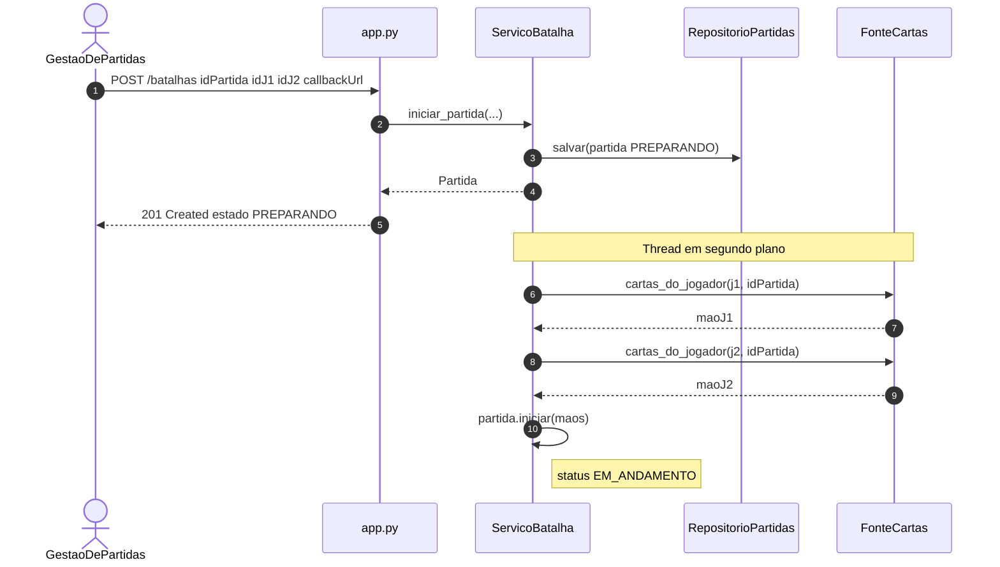
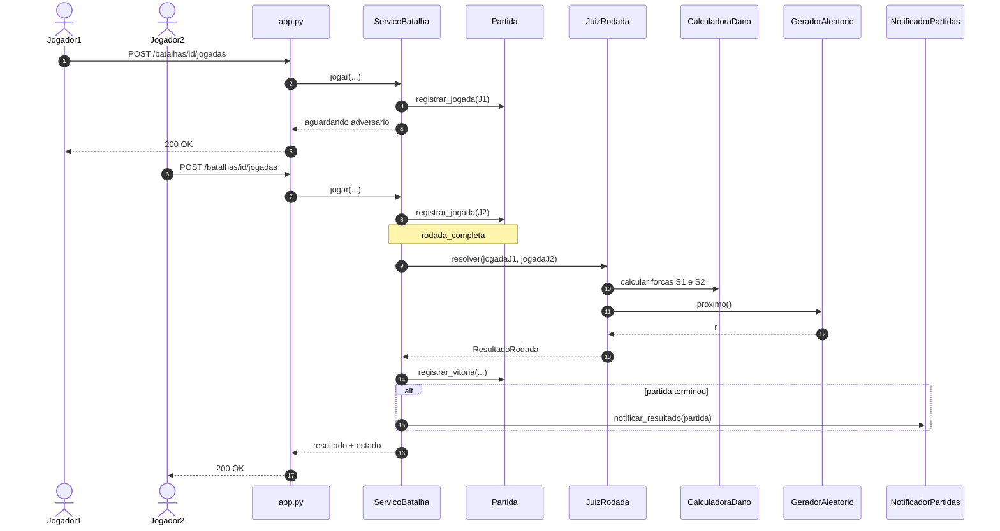

# 04 – Contratos de Integração e Fluxos de Sequência (`S03_Batalha`)

Este documento especifica os contratos HTTP/JSON que conectam o **`S03_Batalha`** aos demais repositórios da organização [`S03-2026-2`](https://github.com/S03-2026-2), bem como os diagramas de sequência de cada operação.

> **Alinhamento pós-feedback:** rotas, payloads e sequências abaixo seguem o código em `src/app.py`, `src/visao_partida.py` e `src/controllers/cliente_*.py`.

---

## 1. Mapa de Integrações na Organização `S03-2026-2`

| Repositório Parceiro | Direção | Porta / Interface no `S03_Batalha` | Endpoint / Operação |
| :--- | :--- | :--- | :--- |
| **`gerenciador-de-partidas`** | Entrada (`Gestão` → `Batalha`) | `IniciadorPartida` | `POST /batalhas` |
| **`gerenciador-de-partidas`** | Saída (`Batalha` → `Gestão`) | `SolicitadorPareamento` | `POST /partidas/fila` |
| **`gerenciador-de-partidas`** | Saída (`Batalha` → `Gestão`) | `NotificadorPartidas` | `callbackUrl` ou `POST /partidas/:id/resultado` |
| **`Distribuicao_de_Cartas`** | Saída (`Batalha` → `Distribuição`) | `FonteCartas` | `GET /jogadores/:idJogador/cartas` (ativado se `DISTRIBUICAO_API_URL` estiver setado; senão mão local) |
| **`Recomendacao-de-cartas`** | Saída (`Batalha` → `Dicas`) | `ProvedorDicas` | `POST /api/dica` (Bearer; sem token → `DicaLocal`) |
| **`PokéAPI` (`pokeapi.co`)** | Saída (`Batalha` → `PokéAPI`) | `ProvedorPokemon` | `GET https://pokeapi.co/api/v2/pokemon/{nomeOuId}` (+ moves) |

---

## 2. Endpoints Expostos pelo `S03_Batalha`

### 2.1. Iniciar Batalha (Acionado pelo `gerenciador-de-partidas`)

- **Rota:** `POST /batalhas`
- **Request Body:**
  ```json
  {
    "idPartida": "550e8400-e29b-41d4-a716-446655440000",
    "idJogador1": "jogador-1",
    "idJogador2": "jogador-2",
    "callbackUrl": "http://localhost:3000/partidas/resultado"
  }
  ```
  `callbackUrl` é opcional; quando presente, o resultado final é POST-ado nessa URL.
- **Response (`201 Created`):** estado inicial da partida (status tipicamente `PREPARANDO` enquanto as mãos são carregadas em segundo plano). Campos principais alinhados a `visao_partida.estado`:
  ```json
  {
    "idPartida": "550e8400-e29b-41d4-a716-446655440000",
    "status": "PREPARANDO",
    "turno": 1,
    "terminou": false,
    "idJogador1": "jogador-1",
    "idJogador2": "jogador-2",
    "jogadorDaVez": null,
    "placar": { "jogador-1": 0, "jogador-2": 0 },
    "cartaEmCampo": { "jogador-1": null, "jogador-2": null },
    "rodadas": []
  }
  ```

### 2.2. Solicitar Entrada na Fila de Batalha
- **Rota:** `POST /batalhas/solicitar`
- **Request Body:** `{ "idJogador": "jogador-1" }`
- **Response (`202 Accepted`):** confirmação de encaminhamento à Gestão.
- **Nota de UI:** a tela `index.html` costuma chamar a Gestão diretamente (`POST /partidas/fila`); este endpoint cobre o UC01 via fachada da Batalha.

### 2.3. Consultar Estado da Batalha
- **Rota:** `GET /batalhas/:idPartida?jogador=:idJogador`
- **Response (`200 OK`):** turno, status (`PREPARANDO` | `EM_ANDAMENTO` | `FINALIZADA` | `ERRO`), placar, campo, histórico de rodadas e, com `?jogador=`, a visão `voce` / `adversario` / `suaVez` (mão do oponente sem revelar a jogada pendente).

### 2.4. Analisar Carta na Partida
- **Rota:** `GET /batalhas/:idPartida/cartas/:idCarta`
- **Response (`200 OK`):**
  ```json
  {
    "id": "carta-1",
    "pokemon": {
      "id": 6,
      "nome": "charizard",
      "tipos": ["fire", "flying"],
      "velocidade": 100,
      "sprite": "https://...",
      "movimentos": [
        { "nome": "flamethrower", "tipo": "fire", "dano": 90 },
        { "nome": "slash", "tipo": "normal", "dano": 70 }
      ]
    }
  }
  ```

### 2.5. Solicitar Dica de Jogada
- **Rota:** `POST /batalhas/:idPartida/dica`
- **Request Body:** `{ "idJogador": "jogador-1" }`
- **Response (`200 OK`):** `{ "dica": "..." }`

### 2.6. Registrar Jogada na Rodada
- **Rota:** `POST /batalhas/:idPartida/jogadas`
- **Request Body:**
  ```json
  {
    "idJogador": "jogador-1",
    "idCarta": "carta-2",
    "nomeMovimento": "hydro-pump"
  }
  ```
  Se o Pokémon do jogador já está em campo (vencedor da rodada anterior), `idCarta` pode ser omitido.
- **Response (`200 OK`):** mensagem + `resultadoRodada` (se a rodada fechou) + `estado` atualizado.

---

## 3. Contratos Consumidos dos Serviços Externos

### 3.1. Notificação de Resultado para `gerenciador-de-partidas`

- **URL:** `partida.callback_url` **ou** `POST {GESTAO_URL}/partidas/{idPartida}/resultado`
- **Payload enviado por `ClienteGestao.montar_corpo`:**
  ```json
  {
    "idPartida": "550e8400-e29b-41d4-a716-446655440000",
    "idVencedor": "jogador-1",
    "idPerdedor": "jogador-2",
    "pontuacaoJogador1": 3,
    "pontuacaoJogador2": 2,
    "detalhes": "Vitória de jogador-1 por 3 a 2 após 5 rodadas."
  }
  ```
- Há retry com backoff leve em falhas de rede.

### 3.2. Distribuição de Cartas
- `GET {DISTRIBUICAO_API_URL}/jogadores/{id}/cartas` → lista com `carta_id`, `pokemon_id`, …
- Sem `DISTRIBUICAO_API_URL`, usa `FonteCartasLocal` (sorteio local enriquecido pela PokéAPI ou catálogo fake).

### 3.3. Recomendação de Cartas
- `POST {RECOMENDACAO_API_URL}/api/dica` com Bearer `RECOMENDACAO_TOKEN`
- Corpo: `{ "jogador": { "campo", "mao", "hp" }, "oponente": { ... } }`
- Sem token ou em erro → `DicaLocal` (estimativa de chance pela `CalculadoraDano`).

---

## 4. Diagramas de Sequência

### SQ01 – Iniciar Partida (Gestão → Batalha → FonteCartas)

A preparação das mãos roda em **segundo plano**: a API responde `201` com status `PREPARANDO` e depois a partida passa a `EM_ANDAMENTO` (ou `ERRO`).



O enriquecimento PokéAPI (quando necessário) ocorre **dentro** da implementação de `FonteCartas` (`ClienteDistribuicao` / `FonteCartasLocal` + `ProvedorPokemon`), não como chamada direta do `ServicoBatalha`.

### SQ02 – Jogar, Processar Rodada e Notificar Vencedor



**Condição de término:** turno ultrapassa 5 **ou** o perdedor da rodada ficou sem cartas (RN05).
