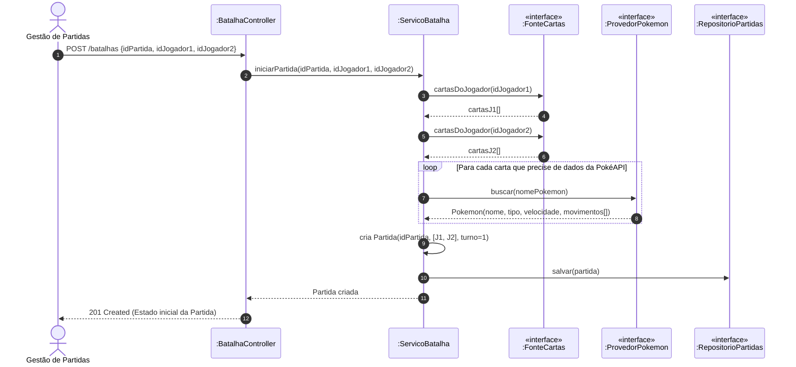

# 04 – Contratos de Integração e Fluxos de Sequência (`S03_Batalha`)

Este documento especifica os contratos HTTP/JSON que conectam o **`S03_Batalha`** aos demais repositórios da organização [`S03-2026-2`](https://github.com/S03-2026-2), bem como os diagramas de sequência de cada operação.

---

## 1. Mapa de Integrações na Organização `S03-2026-2`

| Repositório Parceiro | Direção | Porta / Interface no `S03_Batalha` | Endpoint / Operação |
| :--- | :--- | :--- | :--- |
| **`gerenciador-de-partidas`** | Entrada (`Gestão` $\to$ `Batalha`) | `IniciadorPartida` | `POST /batalhas` |
| **`gerenciador-de-partidas`** | Saída (`Batalha` $\to$ `Gestão`) | `SolicitadorPareamento` | `POST /partidas/fila` |
| **`gerenciador-de-partidas`** | Saída (`Batalha` $\to$ `Gestão`) | `NotificadorPartidas` | `POST /partidas/:id/resultado` |
| **`Distribuicao_de_Cartas`** | Saída (`Batalha` $\to$ `Distribuição`) | `FonteCartas` | `GET /jogadores/:idJogador/cartas` (ou `/cartas?idJogador=...`) |
| **`Recomendacao-de-cartas`** | Saída (`Batalha` $\to$ `Dicas`) | `ProvedorDicas` | `POST /api/recomendacoes` |
| **`PokéAPI` (`pokeapi.co`)** | Saída (`Batalha` $\to$ `PokéAPI`) | `ProvedorPokemon` | `GET https://pokeapi.co/api/v2/pokemon/{nomeOuId}` |

---

## 2. Endpoints Expostos pelo `S03_Batalha`

### 2.1. Iniciar Batalha (Acionado pelo `gerenciador-de-partidas`)
Compatível diretamente com a classe [`HttpBatalhaIntegracao.ts`](https://github.com/S03-2026-2/gerenciador-de-partidas/blob/main/src/infra/integrations/HttpBatalhaIntegracao.ts) do grupo de Gestão de Partidas.

- **Rota:** `POST /batalhas`
- **Request Body:**
  ```json
  {
    "idPartida": "550e8400-e29b-41d4-a716-446655440000",
    "idJogador1": "jogador-1",
    "idJogador2": "jogador-2"
  }
  ```
- **Response (`201 Created`):**
  ```json
  {
    "idPartida": "550e8400-e29b-41d4-a716-446655440000",
    "turno": 1,
    "terminou": false,
    "jogadorDaVez": "jogador-1",
    "placar": {
      "jogador-1": 0,
      "jogador-2": 0
    },
    "cartaEmCampo": {
      "jogador-1": null,
      "jogador-2": null
    }
  }
  ```

### 2.2. Solicitar Entrada na Fila de Batalha
- **Rota:** `POST /batalhas/solicitar`
- **Request Body:**
  ```json
  {
    "idJogador": "jogador-1"
  }
  ```
- **Response (`202 Accepted`):**
  ```json
  {
    "mensagem": "Solicitação de batalha enviada para a Gestão de Partidas."
  }
  ```

### 2.3. Consultar Estado da Batalha
- **Rota:** `GET /batalhas/:idPartida`
- **Response (`200 OK`):**
  Retorna o turno atual (`1..5`), o placar parcial, o Pokémon atualmente ativo em campo de cada jogador (vencedor da rodada anterior), as cartas restantes na mão de cada jogador e o histórico das rodadas já processadas.

### 2.4. Analisar Carta na Partida
- **Rota:** `GET /batalhas/:idPartida/cartas/:idCarta`
- **Response (`200 OK`):**
  ```json
  {
    "id": "carta-1",
    "pokemon": {
      "nome": "charizard",
      "tipo": "fire",
      "velocidade": 100,
      "movimentos": [
        { "nome": "flamethrower", "tipo": "fire", "danoBase": 90 },
        { "nome": "slash", "tipo": "normal", "danoBase": 70 }
      ]
    }
  }
  ```

### 2.5. Solicitar Dica de Jogada
- **Rota:** `POST /batalhas/:idPartida/dica`
- **Request Body:**
  ```json
  {
    "idJogador": "jogador-1"
  }
  ```
- **Response (`200 OK`):**
  ```json
  {
    "dica": "Recomendação: Utilize Blastoise com Hydro Pump (vantagem elemental Água vs Fogo contra Charizard em campo)."
  }
  ```

### 2.6. Registrar Jogada na Rodada (Escolher Carta e Movimento)
- **Rota:** `POST /batalhas/:idPartida/jogadas`
- **Request Body:**
  ```json
  {
    "idJogador": "jogador-1",
    "idCarta": "carta-2",
    "nomeMovimento": "hydro-pump"
  }
  ```
  *(Nota: Se o jogador venceu a rodada anterior, seu Pokémon já está em `cartaEmCampo`; portanto `idCarta` é opcional ou deve corresponder à carta ativa mantida em campo).*
- **Response (`200 OK`):**
  - Se apenas o primeiro jogador da rodada jogou: informa que a jogada foi registrada e aguarda o adversário.
  - Se ambos os jogadores jogaram na rodada: processa imediatamente a rodada via `CalculadoraDano` + sorteio probabilístico, atualiza o campo/mãos e (se for a 5ª rodada) notifica o `gerenciador-de-partidas`, retornando os detalhes da rodada processada.

---

## 3. Contratos Consumidos dos Serviços Externos

### 3.1. Notificação de Resultado para `gerenciador-de-partidas`
Compatível com o endpoint [`POST /partidas/:id/resultado`](https://github.com/S03-2026-2/gerenciador-de-partidas/blob/main/src/http/routes/partidaRoutes.ts) e o controller [`PartidaController.ts`](https://github.com/S03-2026-2/gerenciador-de-partidas/blob/main/src/http/controllers/PartidaController.ts) do grupo de Gestão de Partidas:

- **Rota chamada pelo `ClienteGestao`:** `POST {GESTAO_URL}/partidas/{idPartida}/resultado`
- **Payload enviado:**
  ```json
  {
    "idVencedor": "jogador-1",
    "idPerdedor": "jogador-2",
    "detalhes": "Vitória de jogador-1 por 3 a 2 após 5 rodadas."
  }
  ```
- **Resposta esperada:** `204 No Content`.

---

## 4. Diagramas de Sequência

### SQ01 – Iniciar Partida (Integração Gestão $\to$ Batalha $\to$ Distribuição $\to$ PokéAPI)



### SQ02 – Escolher Carta/Movimento, Processar Rodada e Notificar Vencedor

```mermaid
sequenceDiagram
    autonumber
    actor J1 as Jogador 1
    actor J2 as Jogador 2
    participant Ctrl as :BatalhaController
    participant Serv as :ServicoBatalha
    participant Partida as :Partida
    participant Calc as :CalculadoraDano
    participant Mod as «interface»<br/>:ModificadorDano
    participant Sort as «interface»<br/>:GeradorAleatorio
    participant Notif as «interface»<br/>:NotificadorPartidas

    J1->>Ctrl: POST /batalhas/:id/jogadas {idJogador1, idCarta1, mov1}
    Ctrl->>Serv: registrarJogada(idPartida, idJogador1, idCarta1, mov1)
    Serv->>Partida: registrarJogadaPendente(jogadaJ1)
    Ctrl-->>J1: 200 OK (Aguardando oponente)

    J2->>Ctrl: POST /batalhas/:id/jogadas {idJogador2, idCarta2, mov2}
    Ctrl->>Serv: registrarJogada(idPartida, idJogador2, idCarta2, mov2)
    Serv->>Partida: registrarJogadaPendente(jogadaJ2)

    Note over Serv,Partida: Ambos jogaram na rodada -> processarRodada()
    Serv->>Calc: calcular(mov1, pokemonJ1, pokemonJ2)
    loop Para cada modificador (VantagemElemento, BonusVelocidade)
        Calc->>Mod: aplicar(dano, mov1, pokemonJ1, pokemonJ2)
        Mod-->>Calc: danoModificado
    end
    Calc-->>Serv: forcaJ1 (S1)

    Serv->>Calc: calcular(mov2, pokemonJ2, pokemonJ1)
    loop Para cada modificador (VantagemElemento, BonusVelocidade)
        Calc->>Mod: aplicar(dano, mov2, pokemonJ2, pokemonJ1)
        Mod-->>Calc: danoModificado
    end
    Calc-->>Serv: forcaJ2 (S2)

    Serv->>Serv: P(J1) = S1 / (S1 + S2)
    Serv->>Sort: proximo()
    Sort-->>Serv: valorSorteado r in [0, 1)

    Serv->>Partida: registrarVitoria(vencedorRodada, perdedorRodada)
    Note right of Partida: Mantém Pokémon vencedor em campo;<br/>Remove carta perdedora da mão;<br/>Avança turno.

    alt Turno > 5 (Partida Terminou)
        Serv->>Partida: vencedor() / perdedor()
        Serv->>Notif: notificarResultado(idPartida, idVencedor, idPerdedor, detalhes)
    end

    Serv-->>Ctrl: ResultadoRodada + Estado da Partida
    Ctrl-->>J2: 200 OK (Resultado da rodada e status da partida)
```
