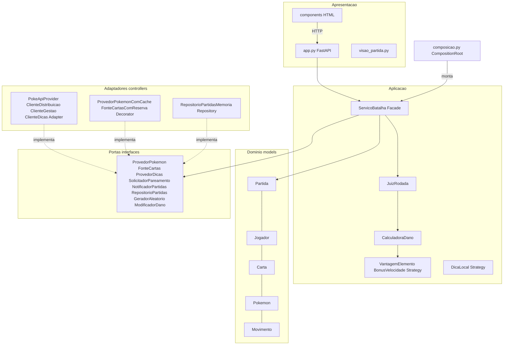

# 05 – Padrões de Projeto (`S03_Batalha`)

Descreve onde cada padrão de projeto e cada princípio SOLID aparece no código do módulo, com localização, trecho relevante e benefício obtido.

---

## 1. Visão geral das camadas



Regra de dependências: `models/` não importa infra; `services/` só conhece `models/` e `interfaces/`; só `composicao.py` instancia concretas de `controllers/`. A pasta `controllers/` concentra os adapters (HTTP, memória e fakes).

---

## 2. Padrões aplicados

### 2.1 Strategy — regras de dano intercambiáveis

**Localização:** `interfaces/modificador_dano.py`, `services/vantagem_elemento.py`, `services/bonus_velocidade.py`, `services/calculadora_dano.py`

**Estrutura:** interface `ModificadorDano` + implementações injetadas em lista.

```python
class CalculadoraDano:
    def __init__(self, modificadores: list[ModificadorDano], dano_padrao: float = 50):
        self._modificadores = list(modificadores)

    def calcular(self, movimento, atacante, defensor) -> float:
        dano = float(movimento.dano or self._dano_padrao)
        for modificador in self._modificadores:
            dano = modificador.aplicar(dano, movimento, atacante, defensor)
        return dano
```

**Benefícios:** OCP — nova regra (clima, STAB) = classe nova; calculadora fechada para mudança.

**Também Strategy:** `ProvedorDicas` (`ClienteDicas` vs `DicaLocal`) e `GeradorAleatorio` (real vs fixo nos testes).

**Teste relacionado:** `tests/test_calculadora_dano.py::test_nova_regra_entra_sem_alterar_a_calculadora`.

---

### 2.2 Facade — um ponto de entrada para os casos de uso

**Localização:** `services/servico_batalha.py`

**Estrutura:** `ServicoBatalha` implementa `IniciadorPartida` + `AcoesJogador` e orquestra domínio + portas.

| Método | Caso de uso |
| :--- | :--- |
| `solicitar_batalha` | UC01 |
| `iniciar_partida` | UC02 / UC03 |
| `jogar` | UC04 / UC07 |
| `analisar_carta` | UC05 |
| `solicitar_dica` | UC06 |
| `verificar_vencedor` | UC08 |

**Benefícios:** `app.py` e clientes externos não precisam conhecer juiz, repositório ou detalhes HTTP dos parceiros — só a fachada.

---

### 2.3 Adapter — integração com parceiros e PokéAPI

**Localização:** `controllers/poke_api_provider.py`, `cliente_distribuicao.py`, `cliente_gestao.py`, `cliente_dicas.py`

| Adapter | Serviço externo | Tradução |
| :--- | :--- | :--- |
| `PokeApiProvider` | PokéAPI | JSON → `Pokemon` / `Movimento` |
| `ClienteDistribuicao` | Distribuicao_de_Cartas | JSON de cartas → `list[Carta]` |
| `ClienteGestao` | gerenciador-de-partidas | fila + resultado (`idPartida`, pontuações, detalhes) |
| `ClienteDicas` | Recomendacao-de-cartas | `POST /api/dica` + Bearer → texto; fallback `DicaLocal` |

**Benefícios:** núcleo isolado de protocolo/JSON; troca de URL/formato sem tocar em `ServicoBatalha`.

---

### 2.4 Decorator — cache e plano B

**Localização:** `controllers/provedor_cache.py`, `controllers/fonte_cartas_local.py` (`FonteCartasComReserva`)

```python
provedor = ProvedorPokemonComCache(PokeApiProvider())
fonte = FonteCartasComReserva(ClienteDistribuicao(url, provedor), FonteCartasLocal(provedor))
```

**Benefícios:** adiciona comportamento (cache / fallback) sem alterar a classe original; LSP preservado.

---

### 2.5 Repository — armazenamento de partidas

**Localização:** `interfaces/repositorio_partidas.py`, `controllers/repositorio_memoria.py`

**Estado atual:** implementação em memória (thread-safe).

**Benefícios:** trocar por banco no futuro = nova classe na mesma interface; fachada intacta.

---

### 2.6 Composition Root / Injeção de Dependência

**Localização:** `composicao.py`

Único arquivo que instancia concretas e lê env (`GESTAO_API_URL`, `DISTRIBUICAO_API_URL`, `RECOMENDACAO_*`, `BATALHA_OFFLINE`).

**Benefícios:** DIP concreto e configurável; offline e integrações opcionais sem `if` espalhados no domínio.

---

### 2.7 Test Doubles (Fakes)

**Localização:** `controllers/provedor_fake.py`, `tests/fakes.py`

`ProvedorFake`, `GestaoFake`, `MaosFixas`, `GeradorFixo` — mesmos contratos, sem internet, sorteio previsível (~43 testes).

---

## 3. SOLID no código (mapa rápido)

| Princípio | Onde ver | Como aparece |
| :--- | :--- | :--- |
| **SRP** | `Partida`, `JuizRodada`, `CalculadoraDano` | Estado × sorteio × força separados |
| **OCP** | `CalculadoraDano` + `ModificadorDano` | Regra nova sem alterar calculadora |
| **LSP** | PokéAPI × Fake × Cache | Substituição sem quebrar o serviço |
| **ISP** | `IniciadorPartida` / `AcoesJogador` / pareamento / notificação | Portas por papel |
| **DIP** | Construtor de `ServicoBatalha` + `composicao.py` | Depende de abstrações |

Detalhamento teórico: [`03-arquitetura-e-solid.md`](03-arquitetura-e-solid.md).

---

## 4. Regras de negócio e onde foram implementadas

| Regra | Arquivo | Teste que prova |
| :--- | :--- | :--- |
| RN01 Revezamento | `Partida.ordem_da_rodada` | `test_revezamento_rodada_par_comeca_o_jogador2` |
| RN02 Vencedor em campo | `Partida.registrar_vitoria` / `registrar_jogada` | `test_vencedor_permanece_em_campo_e_perdedor_perde_a_carta` |
| RN03 Força ponderada | `CalculadoraDano`, modificadores | `test_exemplo_da_documentacao_rn04` |
| RN04 Sorteio `S1/(S1+S2)` | `JuizRodada.resolver` | `test_sorteio_ponderado_decide_a_rodada` |
| RN05 Até 5 rodadas / fim antecipado | `Partida` (término) + `vencedor`/`resultado` | `test_cinco_rodadas_e_fim_de_partida` (+ cenários de mão vazia) |

Detalhe RN03: dual-type multiplica fatores; imunidades originais tratadas como 0.5x para a força nunca zerar o sorteio.

---

## 5. Estado atual, limitações e próximos passos

### Estado atual
- Combate e API operam ponta a ponta, com telas em `components/`.
- Ports & Adapters com Composition Root em `composicao.py`.
- Strategy de dano extensível via `ModificadorDano` (coberto por teste de OCP).
- Fallbacks locais quando Distribuição / Recomendação / PokéAPI não estão configurados (`FonteCartasLocal`, `DicaLocal`, `ProvedorFake`).

### Limitações
- Repositório só em memória (partidas somem ao reiniciar o processo).
- Distribuição e Recomendação só entram no caminho padrão se as variáveis de ambiente estiverem configuradas.
- Sem CI/Docker neste repositório; URLs da UI ficam em `components/config.js`.

### Próximos passos possíveis
- Implementação de `RepositorioPartidas` com persistência.
- Novos modificadores de dano (STAB, clima) via `ModificadorDano`.
- Testes de integração HTTP contra os serviços parceiros.
- Pipeline de CI executando `pytest`.

---

## 6. Como exercitar o fluxo local

1. `cd src && python app.py` (API em `http://localhost:3001`) e, em outro terminal, `cd src/components && python -m http.server 5371`.
2. Abrir `http://localhost:5371`. Com o gerenciador (`USE_MOCK_BATALHA=false`): dois jogadores entram na fila. Sem ele: usar “Criar a partida direto na batalha”.
3. Abrir o link do adversário em outra aba e jogar (carta + golpe).
4. Opcional: `cd src && python -m pytest`.
